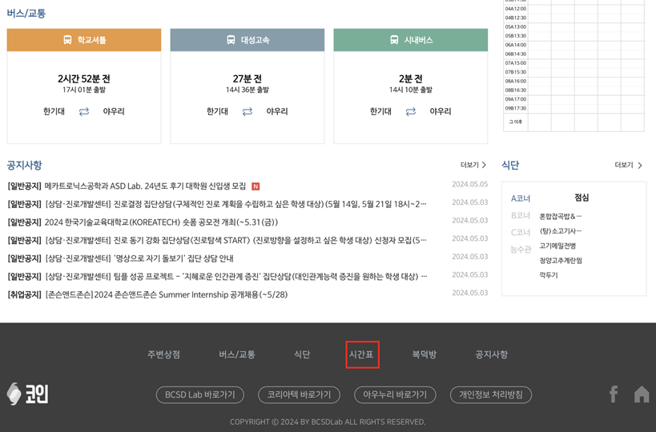

# 2-4. (웹) 푸터_시간표

[← 시간표 로깅 목록](README.md)

플랫폼: WEB  
원문 상태: 완료

과거 로깅·새 로깅과 각 참고사진은 원문의 구간별 연결을 유지합니다.

<!-- logging-section:past:start -->
## 과거 로깅

- event\_label : “footer”
- value : “시간표”
- event\_category : “click”
- 참고 이미지

<!-- logging-section:past:end -->

<!-- logging-section:new:start -->
## 새 로깅

- 설명: 웹 하단 푸터의 서비스 링크에서 시간표를 클릭해 시간표 화면으로 들어가는 경우
- screen\_view: <code>footer</code>
- event\_name: <code>DA1</code>
- event\_label: <code>timetable__footer__timetable_entry__footer_entry__click</code>
- value: 시간표
- event\_category: <code>click</code>

### 참고사진 (WEB 리디자인 · 푸터 시간표)

<b>웹</b>

<b>참고사진 · 웹</b>

[Figma 원본](https://www.figma.com/design/DPlcYuiFxhyT5ULbqec59i/KOIN-Web?node-id=17664-28870) · 2026-11-04. 원본 캡처에 빨간 네모만 추가했다. 빨간 네모는 기존 명세의 시간표 클릭 위치다. 실제 SDK 적용·배포·전송은 미확인이다.

<!-- logging-section:new:end -->

---

원문 정보

원본 ID: `74d0221954bc831ab22401fb98eb62fc`  
[보존 원문](../../_archive/original/notion/pages/74d0221954bc831ab22401fb98eb62fc.md)

