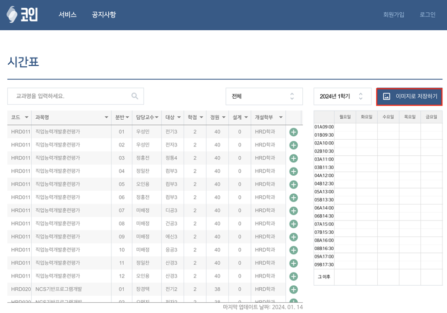
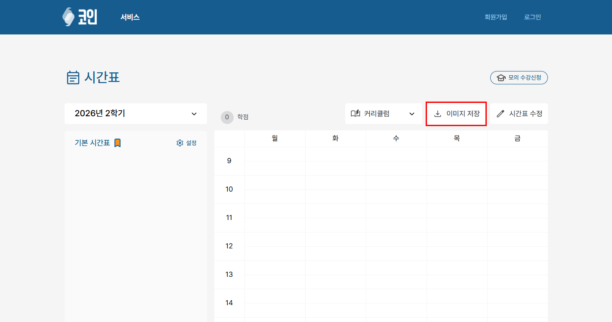
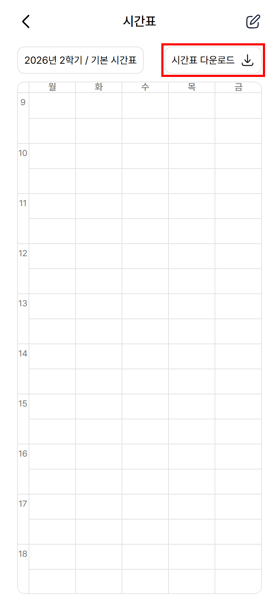

# 2-6. 시간표_이미지 저장 (클릭)

[← 시간표 목록](README.md)

플랫폼: WEB, ANDROID, IOS  
원문 상태: 완료  
[Notion 기준 명세](https://app.notion.com/p/f170221954bc82f1ae6c811a499d60fa)  
원본 ID: `f170221954bc82f1ae6c811a499d60fa`

<!-- notion-body:start -->
## 과거 로깅

- event\_label : “timetable”
- value : “이미지저장”
- event\_category : “click”
- 참고 이미지



## 새 로깅

- 설명: 시간표 화면에서 이미지 저장(모바일은 시간표 다운로드) 버튼을 눌러 시간표를 이미지로 내려받는 경우
- screen\_view: <code>timetable</code>
- event\_name: <code>DA1</code>
- event\_label: <code>timetable__timetable__timetable_export__image_save__click</code>
- value: 이미지 저장
- event\_category: <code>click</code>

### 참고사진 (기능 표시)

<b>웹</b>

<b>참고사진 · 웹</b>

웹 — 이미지 저장 (출처: stage 실제 캡처, 빨간 네모 = 클릭 위치)



<b>모바일</b>

<b>참고사진 · 모바일</b>

모바일 — 시간표 다운로드 (출처: stage 실제 캡처, 빨간 네모 = 클릭 위치)


<!-- notion-body:end -->

<details>
<summary>Notion 원문 속성 전체</summary>

```json
{
  "platform": [
    "WEB",
    "ANDROID",
    "IOS"
  ],
  "url": "https://app.notion.com/p/f170221954bc82f1ae6c811a499d60fa",
  "상태": "완료",
  "생성일": "2026-11-23T13:39:00.344Z",
  "이벤트 이름": "2-6. 시간표\\_이미지 저장 (클릭)",
  "태그": [
    "시간표"
  ]
}
```

</details>
