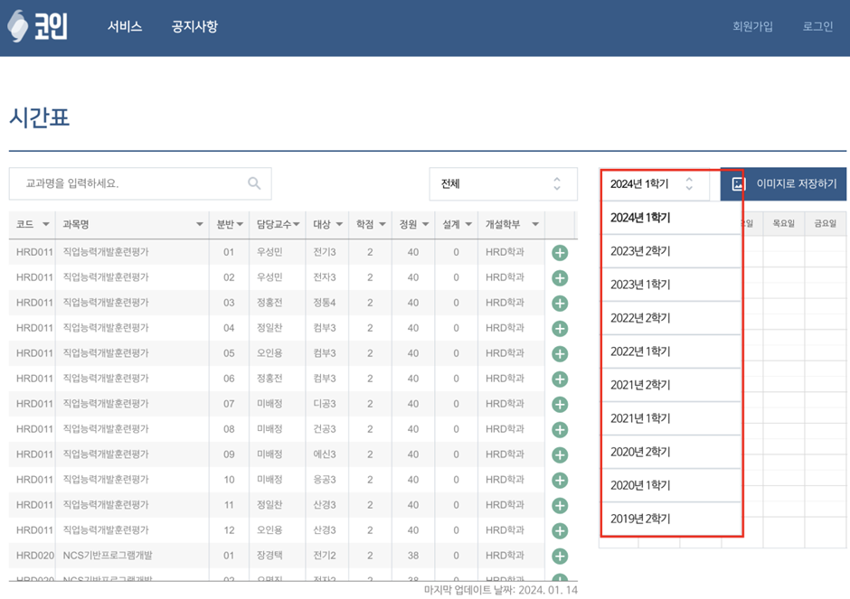
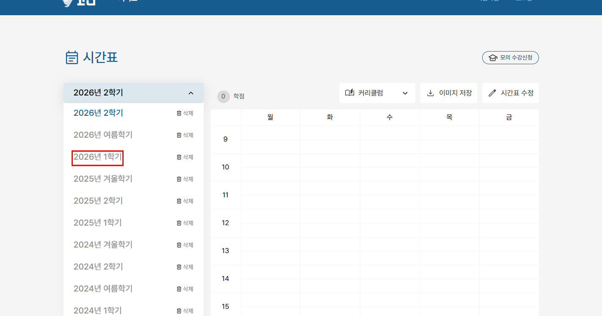

# 2-7. 시간표_학기 드롭다운 (클릭)

[← 시간표 로깅 목록](README.md)

플랫폼: WEB  
원문 상태: 완료

과거 로깅·새 로깅과 각 참고사진은 원문의 구간별 연결을 유지합니다.

<!-- logging-section:past:start -->
## 과거 로깅

- event\_label : “timetable”
- value : “click\_semester\_\{학기\}”
- event\_category : “click”

<!-- logging-section:past:end -->

<!-- logging-section:new:start -->
## 새 로깅

- 설명: 웹 시간표 화면 왼쪽 위 학기 드롭다운을 열고 학기 하나를 골라 그 학기 시간표로 바꾸는 경우
- screen\_view: <code>timetable</code>
- event\_name: <code>DA1</code>
- event\_label: <code>timetable__timetable__semester_manage__select</code>
- value: \{연도\}\_\{학기\} (예: 2026\_1학기)
- event\_category: <code>select</code>

### 참고사진 (기능 표시)

#### 웹

웹 — 학기 드롭다운 학기 선택 (출처: stage 실제 캡처, 빨간 네모 = 클릭 위치)

해당 없음 (웹 전용)

<!-- logging-section:new:end -->

---

원문 정보

원본 ID: `a9c0221954bc8215bb76813a25ddbf3c`  
[보존 원문](../../_archive/original/notion/pages/a9c0221954bc8215bb76813a25ddbf3c.md)

