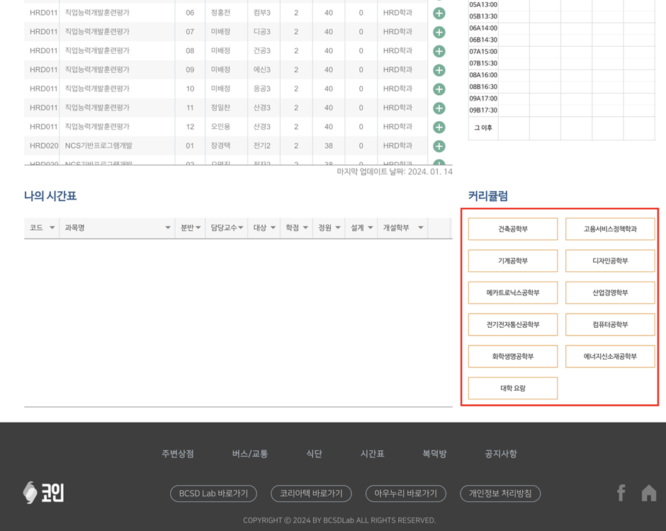
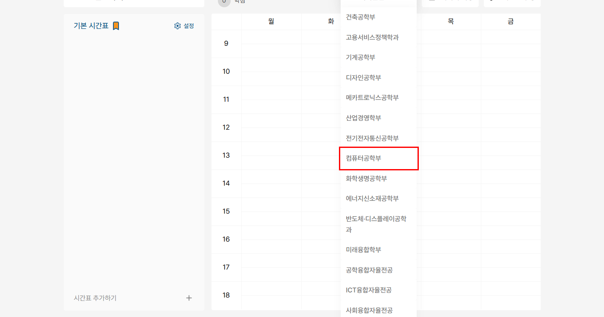

# 2-8. 시간표_커리큘럼 (클릭)

[← 시간표 목록](README.md)

플랫폼: WEB  
원문 상태: 완료  
[Notion 기준 명세](https://app.notion.com/p/50c0221954bc828ab2e501134fa6bb43)  
원본 ID: `50c0221954bc828ab2e501134fa6bb43`

<!-- notion-body:start -->
## 과거 로깅

- event\_label : “timetable”
- value : “click\_curriculum\_\{학과\}”
- event\_category : “click”
- 참고 이미지



## 새 로깅

- 설명: 웹 시간표 화면의 커리큘럼 드롭다운을 열고 학과(학부)를 골라 해당 학과 커리큘럼을 보는 경우
- screen\_view: <code>timetable</code>
- event\_name: <code>DA1</code>
- event\_label: <code>timetable__timetable__search__curriculum__select</code>
- value: \{학과\} (예: 디자인ㆍ건축공학부) · 학과명은 드롭다운 표기 그대로(가운뎅점 ㆍ 포함)
- event\_category: <code>select</code>

### 참고사진 (기능 표시)

<b>웹</b>

<b>참고사진 · 웹</b>

웹 — 커리큘럼 학과 선택 (출처: stage 실제 캡처, 빨간 네모 = 클릭 위치)



<b>모바일</b>

<b>참고사진 · 모바일</b>

해당 없음 (웹 전용)
<!-- notion-body:end -->

<details>
<summary>Notion 원문 속성 전체</summary>

```json
{
  "platform": [
    "WEB"
  ],
  "url": "https://app.notion.com/p/50c0221954bc828ab2e501134fa6bb43",
  "상태": "완료",
  "생성일": "2026-11-23T13:39:01.939Z",
  "이벤트 이름": "2-8. 시간표\\_커리큘럼 (클릭)",
  "태그": [
    "시간표"
  ]
}
```

</details>
