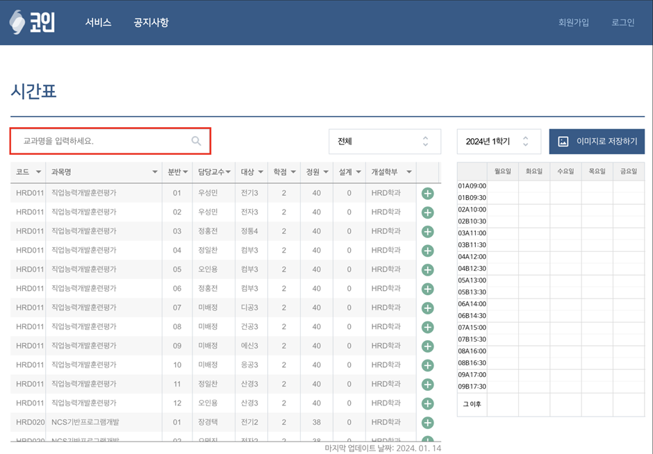
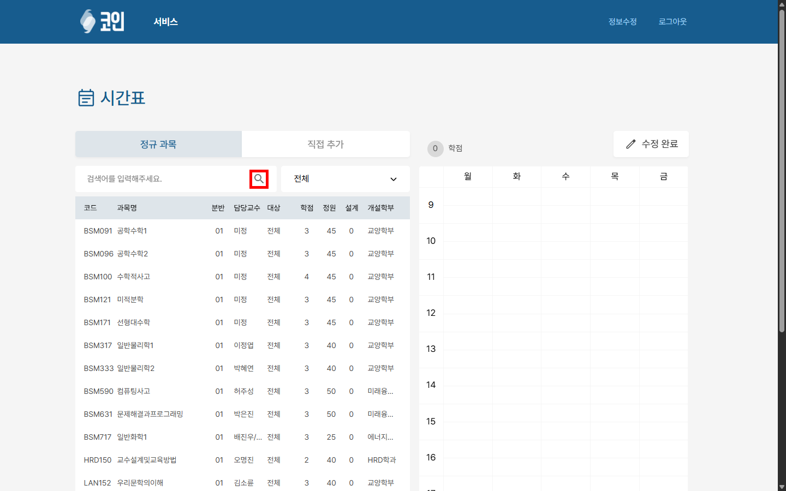

# 2-9. 시간표 검색_돋보기 (클릭)

[← 시간표 로깅 목록](README.md)

플랫폼: WEB  
원문 상태: 완료

과거 로깅·새 로깅과 각 참고사진은 원문의 구간별 연결을 유지합니다.

<!-- logging-section:past:start -->
## 과거 로깅

- event\_label : “timetable”
- value : “search”
- event\_category : “click”
- 참고 이미지

<!-- logging-section:past:end -->

<!-- logging-section:new:start -->
## 새 로깅

- 설명: 웹 시간표 수정 화면(정규 과목 탭)의 과목 검색창에서 돋보기를 눌러(또는 엔터로) 과목을 검색하는 경우
- screen\_view: <code>timetable_edit</code>
- event\_name: <code>DA1</code>
- event\_label: <code>timetable__timetable_edit__search__click</code>
- value: 검색 (사용자가 입력한 검색어는 보내지 않는다)
- event\_category: <code>click</code>

### 참고사진 (기능 표시)

<b>웹</b>

<b>참고사진 · 웹</b>

웹 — 과목 검색 돋보기 (출처: stage 실제 캡처, 로그인 상태, 빨간 네모 = 클릭 위치)

<b>모바일</b>

<b>참고사진 · 모바일</b>

해당 없음 (웹 전용)

<!-- logging-section:new:end -->

---

원문 정보

원본 ID: `7b70221954bc839a9a3f017e8f52b6eb`  
[보존 원문](../../_archive/original/notion/pages/7b70221954bc839a9a3f017e8f52b6eb.md)

