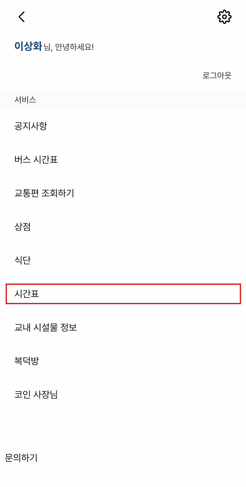
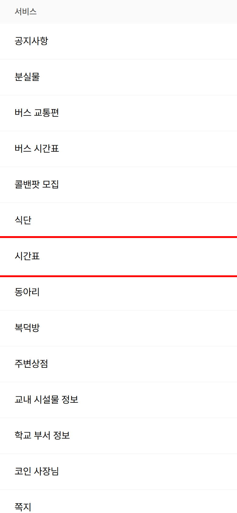

# [레거시·이관 원문] 2-5. (앱, 반응형 웹) 햄버거_시간표

[← 시간표 목록](README.md)

플랫폼: ANDROID, IOS  
원문 상태: 완료  
[Notion 기준 명세](https://app.notion.com/p/9d40221954bc837fa57201c1f0cf166c)  
원본 ID: `9d40221954bc837fa57201c1f0cf166c`

<!-- notion-body:start -->
## 과거 로깅

- event\_label : “hamburger”
- value : “시간표”
- event\_category : “click”
- 참고 이미지



- 설명: 모바일 상단 메뉴(☰, 햄버거)를 열고 서비스 목록에서 시간표를 클릭해 시간표 화면으로 들어가는 경우
- screen\_view: <code>main_category</code>
- event\_name: <code>DA1</code>
- event\_label: <code>timetable__main_category__timetable_entry__category_entry__click</code>
- value: 시간표
- event\_category: <code>click</code>

### 참고사진 (기능 표시)

<b>웹</b>

<b>참고사진 · 웹</b>

해당 없음 (모바일 전용)

<b>모바일</b>

<b>참고사진 · 모바일</b>

모바일 — 햄버거 메뉴의 시간표 (출처: stage 실제 캡처, 빨간 네모 = 클릭 위치)



## 새 로깅

레거시. [3-6 카테고리 내부 클릭 (현재 로깅) 2026.08.30 이후 찍히는 로깅](https://app.notion.com/p/ea70221954bc837d824b81d034d72403)를 따른다.
<!-- notion-body:end -->

<details>
<summary>Notion 원문 속성 전체</summary>

```json
{
  "platform": [
    "ANDROID",
    "IOS"
  ],
  "url": "https://app.notion.com/p/9d40221954bc837fa57201c1f0cf166c",
  "상태": "완료",
  "생성일": "2026-11-23T13:39:00.224Z",
  "이벤트 이름": "\\[레거시·이관 원문\\] 2-5. (앱, 반응형 웹) 햄버거\\_시간표",
  "태그": [
    "시간표"
  ]
}
```

</details>
