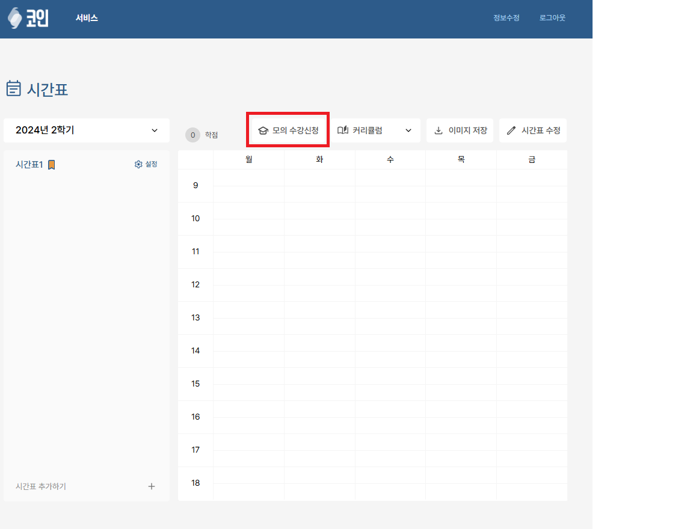
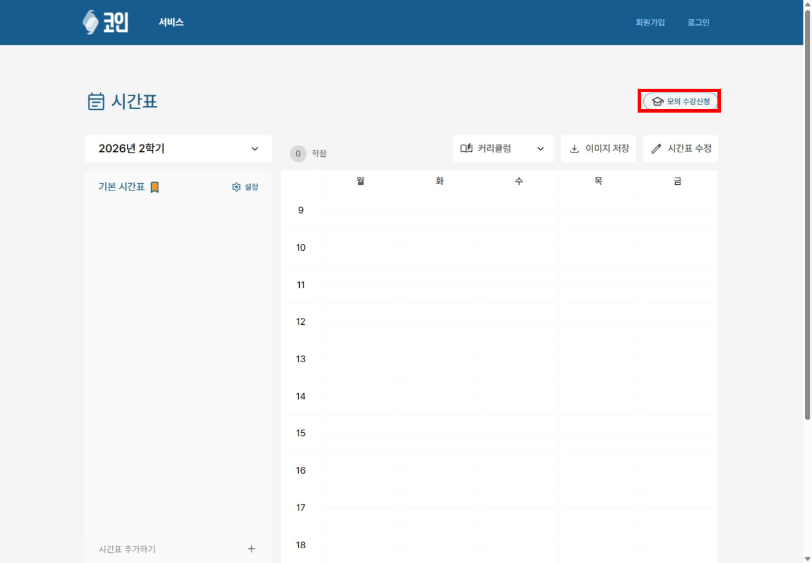

# 0. (웹) 모의수강신청 진입

[← 모의수강신청 목록](README.md)

플랫폼: WEB  
원문 상태: 로깅 필요  
[Notion 기준 명세](https://app.notion.com/p/c0c0221954bc8270be5381ef9726eb8f)  
원본 ID: `c0c0221954bc8270be5381ef9726eb8f`

<!-- notion-body:start -->
## 과거 로깅

- event\_label : “application\_training”
- value :
- event\_category : “click”
- 참고 이미지



## 새 로깅

- 설명: 웹 시간표 화면 우측 상단 ‘모의 수강신청’ 버튼을 클릭한다.
- screen\_view: <code>timetable</code>
- event\_label: <code>course_practice__timetable__course_application__entry__click</code>
- event\_name: <code>DA2</code>
- event\_category: <code>click</code>
- value: 모의수강신청

### 참고사진 (기능 표시)

<b>참고사진 · 웹</b>

실제 데스크톱 웹 시간표 캡처(2026-10-15, 1425×990). 빨간 박스는 우측 상단 진입 버튼.


<!-- notion-body:end -->

<details>
<summary>Notion 원문 속성 전체</summary>

```json
{
  "platform": [
    "WEB"
  ],
  "url": "https://app.notion.com/p/c0c0221954bc8270be5381ef9726eb8f",
  "상태": "로깅 필요",
  "이름": "0. (웹) 모의수강신청 진입",
  "태그": [
    "0. 코인 메인화면_모의수강신청"
  ]
}
```

</details>
