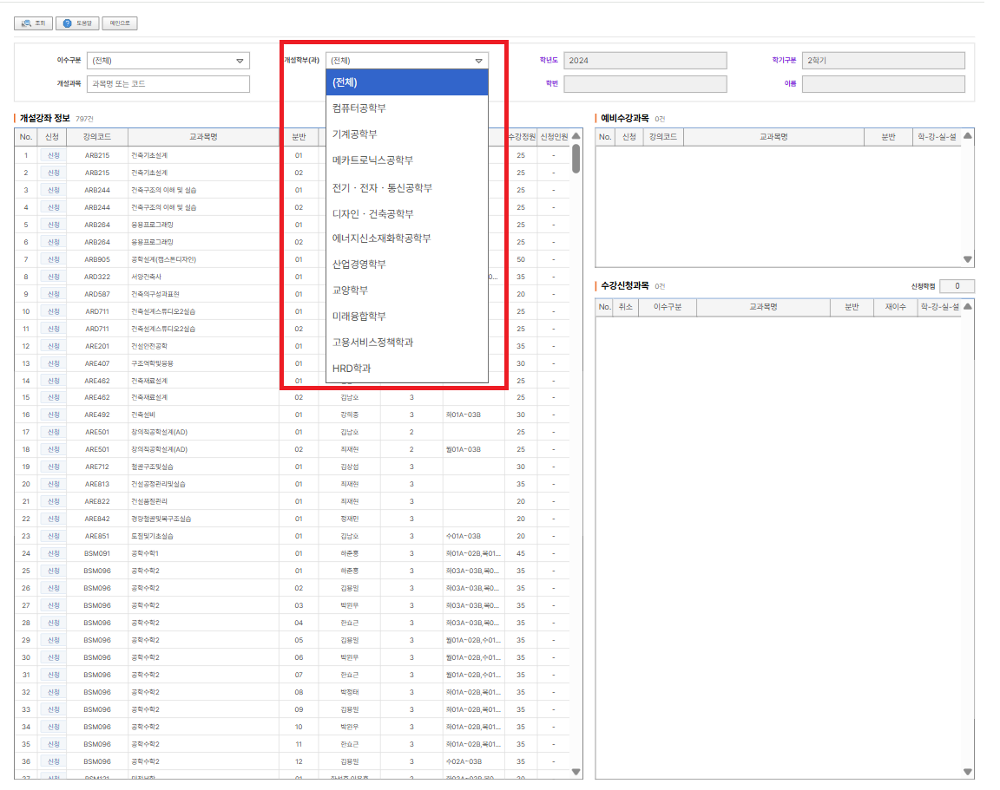
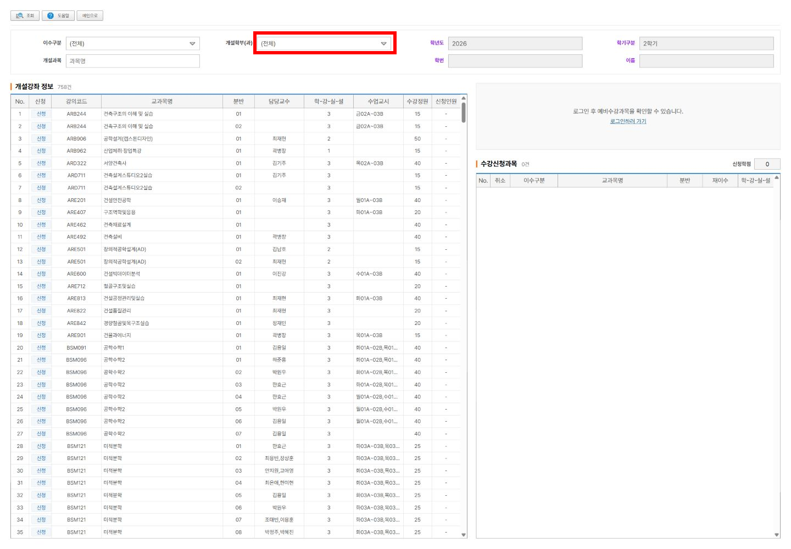

# 1-1. 모의수강신청_개설학부(과) 선택

[← 모의수강신청 로깅 목록](README.md)

플랫폼: WEB  
원문 상태: 로깅 필요

과거 로깅·새 로깅과 각 참고사진은 원문의 구간별 연결을 유지합니다.

<!-- logging-section:past:start -->
## 과거 로깅

- event\_label : “application\_training\_all”
- value: \{”학부 명”\}
- event\_category : “click”

<!-- logging-section:past:end -->

<!-- logging-section:new:start -->
## 새 로깅

- 설명: 모의수강신청 화면에서 개설학부(과) 드롭다운에서 학부를 선택한다.
- screen\_view: <code>course_practice</code>
- event\_label: <code>course_practice__course_practice__search__department__click</code>
- event\_name: <code>DA2</code>
- value: \{학부 명\}
- event\_category: <code>click</code>

### 참고사진 (기능 표시)

<b>웹(데스크톱)</b>

#### 웹

화면 정의의 실제 데스크톱 웹 캡처(2026-10-13). 이번 작업은 기존 캡처를 사용. 비로그인 상태.

<!-- logging-section:new:end -->

---

원문 정보

원본 ID: `3740221954bc837096f40170d9d39d9e`  
[보존 원문](../../_archive/original/notion/pages/3740221954bc837096f40170d9d39d9e.md)

