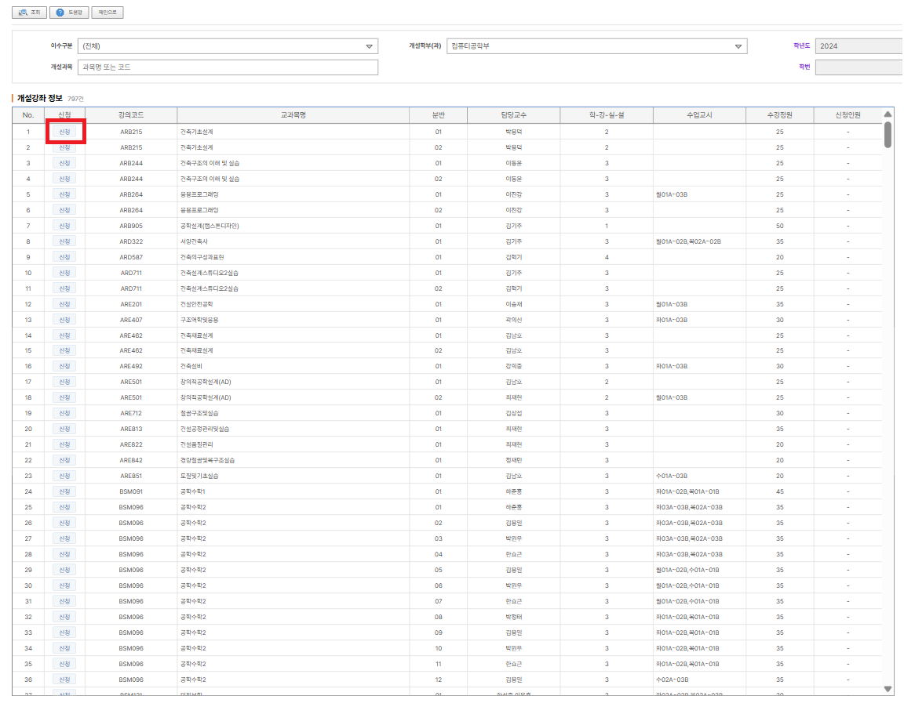
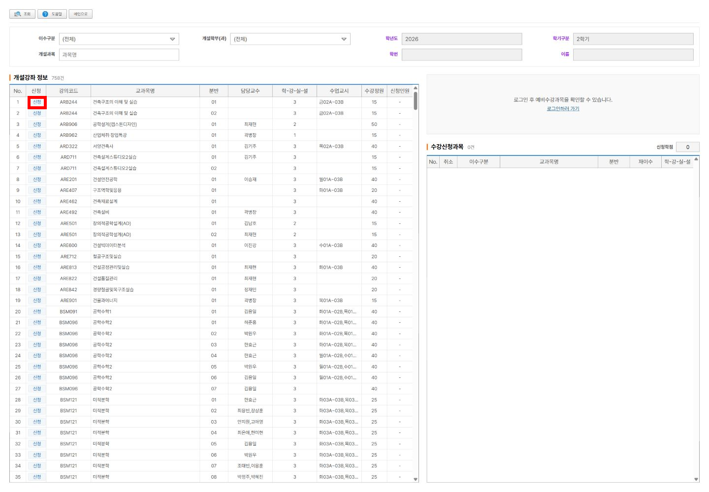

# 1-3. 모의수강신청_강좌 신청 클릭

[← 모의수강신청 목록](README.md)

플랫폼: WEB  
원문 상태: 로깅 필요  
[Notion 기준 명세](https://app.notion.com/p/9e30221954bc82a5956a0169ef3c819c)  
원본 ID: `9e30221954bc82a5956a0169ef3c819c`

<!-- notion-body:start -->
## 과거 로깅

- event\_label : “application\_training\_apply”
- value:
- event\_category : “click”
- 참고 이미지



## 새 로깅

- 설명: 모의수강신청 화면에서 개설강좌 목록의 신청 버튼을 클릭한다.
- screen\_view: <code>course_practice</code>
- event\_label: <code>course_practice__course_practice__course_application__lecture__click</code>
- event\_name: <code>DA2</code>
- value: 개설강좌 신청
- event\_category: <code>click</code>

### 참고사진 (기능 표시)

<b>웹(데스크톱)</b>

<b>참고사진 · 웹</b>

화면 정의의 실제 데스크톱 웹 캡처(2026-10-13). 이번 작업은 기존 캡처를 사용. 비로그인 상태.


<!-- notion-body:end -->

<details>
<summary>Notion 원문 속성 전체</summary>

```json
{
  "platform": [
    "WEB"
  ],
  "url": "https://app.notion.com/p/9e30221954bc82a5956a0169ef3c819c",
  "상태": "로깅 필요",
  "이름": "1-3. 모의수강신청\\_강좌 신청 클릭",
  "태그": [
    "1. 모의수강신청_메인화면"
  ]
}
```

</details>
