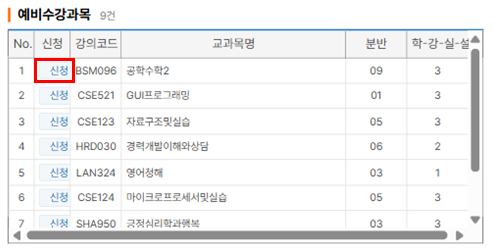

# 1-4. 모의수강신청_예비수강과목 신청 클릭

[← 모의수강신청 로깅 목록](README.md)

플랫폼: WEB  
원문 상태: 로깅 필요

과거 로깅·새 로깅과 각 참고사진은 원문의 구간별 연결을 유지합니다.

<!-- logging-section:past:start -->
## 과거 로깅

- event\_label : “application\_training\_pre\_apply” 

- value: 

- event\_category : “click”

- 참고 이미지

<!-- logging-section:past:end -->

<!-- logging-section:new:start -->
## 새 로깅

- 설명: 모의수강신청 화면의 예비수강과목에서 신청 버튼을 클릭한다.
- screen\_view: <code>course_practice</code>
- event\_label: <code>course_practice__course_practice__course_application__preselected__click</code>
- event\_name: <code>DA2</code>
- value: 기존 미기재 유지
- event\_category: <code>click</code>

### 참고사진 (기능 표시)

<b>웹(데스크톱)</b>

<b>참고사진 · 웹</b>

기존 웹 명세 캡처 사본. 예비수강과목 영역과 신청 버튼은 2026-10-15 로그인 후 실제 WEB에서도 확인했다. 아래 사진 자체는 기존 자료다.

<!-- logging-section:new:end -->

---

원문 정보

원본 ID: `8db0221954bc8239841c01b8d00d3d71`  
[보존 원문](../../_archive/original/notion/pages/8db0221954bc8239841c01b8d00d3d71.md)

