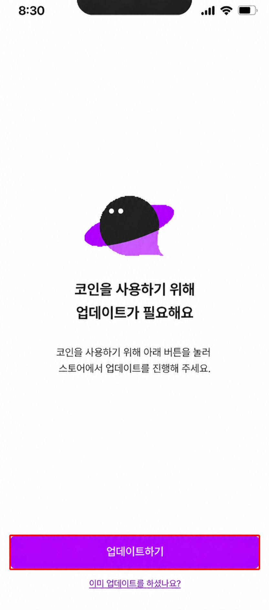

# 2. 업데이트하기 클릭

[← 강제 업데이트 목록](README.md)

플랫폼: ANDROID, IOS  
원문 상태: 로깅 필요  
[Notion 기준 명세](https://app.notion.com/p/c390221954bc82ffaec401e93ba69ace)  
원본 ID: `c390221954bc82ffaec401e93ba69ace`

<!-- notion-body:start -->
## 새 로깅

- 설명: 강제 업데이트 화면 하단 업데이트하기 버튼을 클릭해 스토어 이동을 시도할 때 1회 기록한다.
- screen\_view: <code>forced_update</code>
- event\_name: <code>DA1</code>
- event\_label: <code>main__forced_update__app_update__store_entry__click</code>
- value: 업데이트하기
- event\_category: <code>click</code>

## 검토사항

- 실제 스토어 도착·설치·업데이트 완료를 의미하지 않는다.
- 새 계약의 event\_label·screen\_view·event\_name은 IOS·ANDROID·WEB에서 동일하다. 실제 기능이 없는 플랫폼에는 전송하지 않는다. SDK 구현·배포·실수집 검증은 별도다.
- 기존 코드·값 차이·검토 이력은 [Notion 원문](https://app.notion.com/p/4159ae650b5980098d00ede0491dca90)에 보존한다. 신·구 label을 한 동작에 병행 전송하지 않는다.

### 참고사진 (업데이트하기 클릭)

<b>웹</b>

<b>참고사진 · 웹</b>

웹 (PC·모바일 웹) — 해당 화면의 실제 이미지 미확보. 앱 이미지를 웹 이미지로 대신 표시하지 않는다.

<b>모바일</b>

<b>참고사진 · 모바일</b>

모바일 — 하단 업데이트하기 버튼만 빨간 네모로 표시했다. 사용자 제공 큰 디자인 이미지를 편집한 참고사진이며 실기기·SDK 검증 사진은 아니다.


<!-- notion-body:end -->

<details>
<summary>Notion 원문 속성 전체</summary>

```json
{
  "platform": [
    "ANDROID",
    "IOS"
  ],
  "url": "https://app.notion.com/p/c390221954bc82ffaec401e93ba69ace",
  "상태": "로깅 필요",
  "이름": "2. 업데이트하기 클릭"
}
```

</details>
