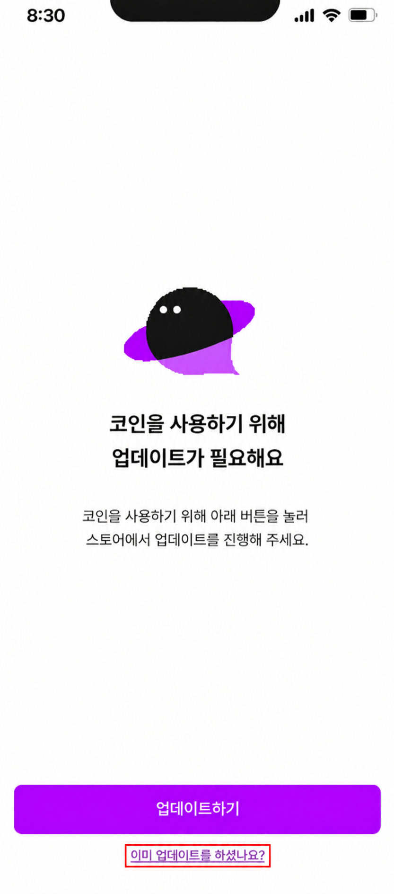

# 3. 이미 업데이트했나요 클릭
<!-- representative-note:start -->
> 이 페이지는 중복 목록에서 제외한 보존 원본입니다. [대표 명세](3.-%EC%9D%B4%EB%AF%B8-%EC%97%85%EB%8D%B0%EC%9D%B4%ED%8A%B8%ED%96%88%EB%82%98%EC%9A%94-%ED%81%B4%EB%A6%AD.md)에서 시작하세요. 아래 원문·과거/새 정의·이미지는 그대로 보존합니다.
<!-- representative-note:end -->

[← 강제 업데이트 로깅 목록](README.md)

플랫폼: ANDROID · IOS  
원문 상태: 로깅 필요

과거 로깅·새 로깅과 각 참고사진은 원문의 구간별 연결을 유지합니다.

<!-- logging-section:new:start -->
## 새 로깅

- 설명: 강제 업데이트 화면의 이미 업데이트를 하셨나요? 링크를 클릭해 안내 팝업을 열 때 1회 기록한다.
- screen\_view: <code>forced_update</code>
- event\_name: <code>DA1</code>
- event\_label: <code>main__forced_update__app_update__already_done__click</code>
- value: 이미업데이트
- event\_category: <code>click</code>

검토사항

- 업데이트 완료 판정이나 팝업 버튼 클릭 이벤트가 아니다.
- 새 계약의 event\_label·screen\_view·event\_name은 IOS·ANDROID·WEB에서 동일하다. 실제 기능이 없는 플랫폼에는 전송하지 않는다. SDK 구현·배포·실수집 검증은 별도다.
- 기존 코드·값 차이·검토 이력은 원문 (원문 ID: 4159ae650b5980098d00ede0491dca90)에 보존한다. 신·구 label을 한 동작에 병행 전송하지 않는다.

<!-- logging-section:new:end -->

### 참고사진 (이미 업데이트했나요 클릭)

<b>웹</b>

<b>참고사진 · 웹</b>

웹 (PC·모바일 웹) — 해당 화면의 실제 이미지 미확보. 앱 이미지를 웹 이미지로 대신 표시하지 않는다.

<b>모바일</b>

<b>참고사진 · 모바일</b>

모바일 — 하단 이미 업데이트를 하셨나요? 링크만 빨간 네모로 표시했다. 사용자 제공 큰 디자인 이미지를 편집한 참고사진이며 실기기·SDK 검증 사진은 아니다.

---

원문 정보

원본 ID: `e2b0221954bc829e844681434ddf4197`  
[보존 원문](../../_archive/original/notion/pages/e2b0221954bc829e844681434ddf4197.md)

