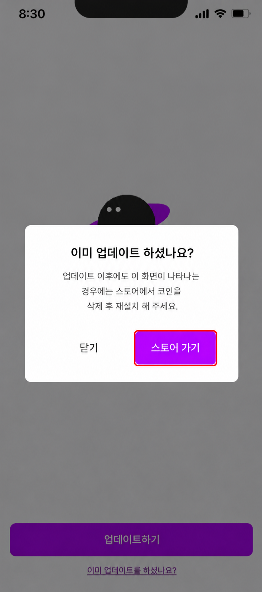

# 5. 업데이트 확인 팝업 스토어 가기

[← 강제 업데이트 로깅 목록](README.md)

과거 로깅·새 로깅과 각 참고사진은 원문의 구간별 연결을 유지합니다.

<!-- logging-section:new:start -->
## 새 로깅

- 설명: 이미 업데이트했나요? 안내 팝업의 스토어 가기 버튼을 클릭해 스토어 이동을 시도할 때 1회 기록한다.
- screen\_view: <code>forced_update</code>
- event\_name: <code>DA1</code>
- event\_label: <code>main__forced_update__update_popup__store_entry__click</code>
- value: 스토어 가기
- event\_category: <code>click</code>

검토사항

- 본문 업데이트하기 버튼과 클릭 위치가 다른 별도 계약이며 업데이트 완료를 의미하지 않는다.
- 새 계약의 event\_label·screen\_view·event\_name은 IOS·ANDROID·WEB에서 동일하다. 실제 기능이 없는 플랫폼에는 전송하지 않는다. SDK 구현·배포·실수집 검증은 별도다.
- 기존 코드·값 차이·검토 이력은 [강제 업데이트 · 로깅 명세](../../_archive/original/notion/pages/4150221954bc81658736d9971120feaa.md)에 보존한다. 신·구 label을 한 동작에 병행 전송하지 않는다.

<!-- logging-section:new:end -->

### 참고사진 (업데이트 확인 팝업 스토어 가기)

<b>웹</b>

<b>참고사진 · 웹</b>

웹 (PC·모바일 웹) — 해당 화면의 실제 이미지 미확보. 앱 이미지를 웹 이미지로 대신 표시하지 않는다.

<b>모바일</b>

<b>참고사진 · 모바일</b>

모바일 — 팝업 오른쪽 스토어 가기 버튼만 빨간 네모로 표시했다. 사용자 제공 큰 디자인 이미지를 편집한 참고사진이며 실기기·SDK 검증 사진은 아니다.

---

원문 정보

원본 ID: `4150221954bc81c4bd1ec8bb60a227e2`  
[보존 원문](../../_archive/original/notion/pages/4150221954bc81c4bd1ec8bb60a227e2.md)

