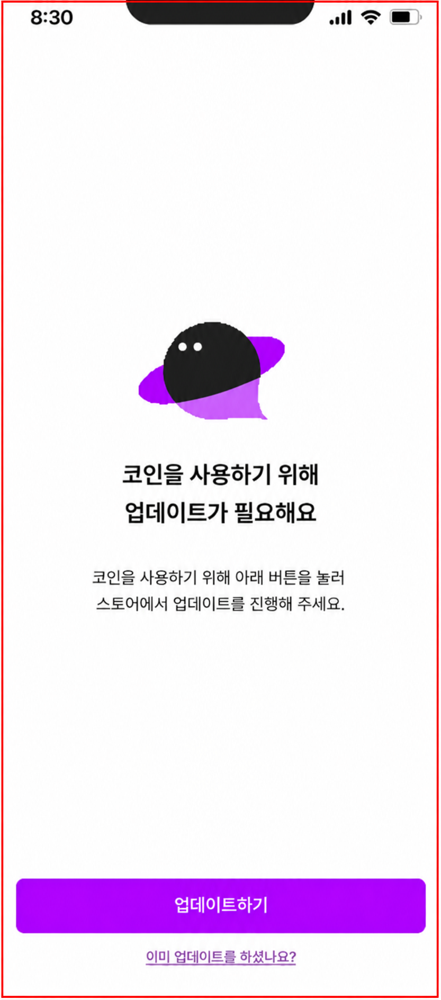

# 6. 강제 업데이트 화면 이탈
<!-- representative-note:start -->
> 이 페이지는 중복 목록에서 제외한 보존 원본입니다. [대표 명세](6.-%EA%B0%95%EC%A0%9C-%EC%97%85%EB%8D%B0%EC%9D%B4%ED%8A%B8-%ED%99%94%EB%A9%B4-%EC%9D%B4%ED%83%88.md)에서 시작하세요. 아래 원문·과거/새 정의·이미지는 그대로 보존합니다. **대표 문서와 라벨·category가 달라 검토가 필요한 원본입니다. 현재 전송값으로 자동 채택하지 않습니다.**
<!-- representative-note:end -->

[← 강제 업데이트 로깅 목록](README.md)

원문 상태: 로깅 필요

과거 로깅·새 로깅과 각 참고사진은 원문의 구간별 연결을 유지합니다.

<!-- logging-section:new:start -->
## 새 로깅

- 설명: 강제 업데이트 화면이 떠 있는 상태에서 앱이 백그라운드로 전환되는 등 앱 이탈이 감지될 때 1회 기록한다. 같은 이탈 콜백에서 중복 전송하지 않는다.
- screen\_view: <code>forced_update</code>
- event\_name: <code>DA1</code>
- event\_label: <code>main__forced_update__app_update__exit</code>
- value: 앱 이탈
- event\_category: <code>exit</code>

<!-- logging-section:new:end -->

### 참고사진 (강제 업데이트 화면 이탈)

해당 기능 지원·실제 이미지 미확인. 앱 사진을 웹 실제 화면으로 대신 표시하지 않는다.

#### 모바일

빨간 외곽선은 이탈 전에 표시되는 강제 업데이트 화면의 범위다. 특정 버튼이나 이탈 제스처를 뜻하지 않는다.

---

원문 정보

원본 ID: `8d40221954bc829e831601b2fdd18819`  
[보존 원문](../../_archive/original/notion/pages/8d40221954bc829e831601b2fdd18819.md)

