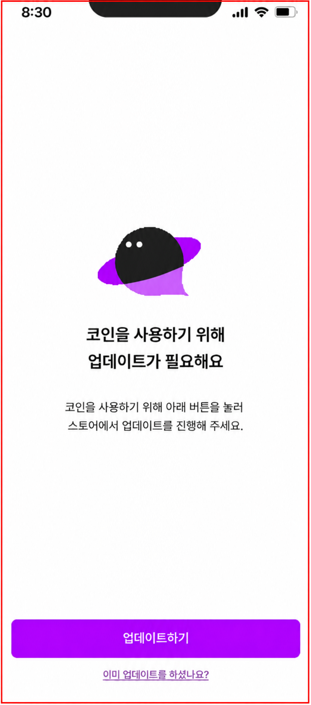

# 6. 강제 업데이트 화면 이탈
<!-- representative-note:start -->
> 이 페이지가 서비스 목록의 대표 명세입니다. 추가 원본·플랫폼별 과거 정의와 사진은 아래 보존 원본에서 확인할 수 있습니다. **화면 이탈은 원문 간 라벨·category가 다릅니다. 기존 수집 계약과 전환 초안의 구분을 유지하며, 이번 목록 통합으로 전환값을 확정하지 않았습니다.**
<!-- representative-note:end -->

[← 강제 업데이트 로깅 목록](README.md)

과거 로깅·새 로깅과 각 참고사진은 원문의 구간별 연결을 유지합니다.

<!-- logging-section:past:start -->
## 과거 로깅 · 기존 수집 계약

- 설명: 강제 업데이트 화면이 떠 있는 상태에서 사용자가 앱을 이탈하면 기록하는 이벤트다.
- event\_name: ANDROID <code>force_update</code> / IOS <code>FORCE_UPDATE</code>
- event\_label: <code>forced_update_exit</code>
- value: ANDROID: 홈버튼 / 나가기버튼 · IOS: 홈버튼
- event\_category: <code>page_exit</code>
- 기존 발생 조건: Android onUserLeaveHint·나가기 버튼, iOS 백그라운드 진입. 코드 스냅샷 기준이며 최신 배포 상태는 미확인이다.

<!-- logging-section:past:end -->

- 새 로깅
  - 설명: 강제 업데이트 화면이 떠 있는 상태에서 앱이 백그라운드로 전환되는 등 앱 이탈이 감지될 때 1회 기록한다. 같은 이탈 콜백에서 중복 전송하지 않는다.
  - screen\_view: <code>forced_update</code>
  - event\_name: <code>DA1</code>
  - event\_label: <code>main__forced_update__app_update__exit__page_exit</code>
  - value: 앱 이탈
  - event\_category: <code>page_exit</code>
  - 검토사항
    - 위 새 라벨·공통 value는 전환 초안이다. page\_exit의 공통 category 등록과 SDK 발생 조건 확정 전에는 기존 forced\_update\_exit를 그대로 유지한다. 양식 변경이 구현·배포 완료를 뜻하지 않는다.
    - event\_name은 이번에 제시한 양식의 DA1로 작성했다. 기존 main 공통표의 DA2와 차이가 있으므로 강제 업데이트 전체 담당값 확정 시 함께 맞춘다.
    - 새 계약은 IOS·ANDROID·WEB에서 같은 동작에 같은 event\_label·screen\_view·event\_name을 사용한다. 실제 기능이 없는 플랫폼에는 전송하지 않는다. SDK 구현·배포·실수집 검증은 별도다.
    - 스토어 이동 중에도 백그라운드 전환이 발생할 수 있다. 업데이트 거절·실패·앱 강제 종료를 의미하지 않으며 업데이트하기 버튼 클릭 수와 같은 의미로 합산하지 않는다.
    - 프로세스 강제 종료 때 반드시 전송되는 이벤트로 해석하지 않는다. 기존 플랫폼별 값과 코드 근거는 과거 로깅에 보존한다. 같은 이탈에 신·구 라벨을 병행 전송하지 않는다.
    - 기준 문서: [강제 업데이트 · 로깅 명세](../../_archive/original/notion/pages/4150221954bc81658736d9971120feaa.md).

### 참고사진 (강제 업데이트 화면 이탈)

웹 (PC·모바일 웹) — 해당 화면의 실제 이미지 미확보. 앱 이미지를 웹 이미지로 대신 표시하지 않는다.

#### 모바일

모바일 — 빨간 외곽선은 이탈 전에 표시되는 강제 업데이트 화면의 범위다. 특정 버튼이나 이탈 제스처를 뜻하지 않는다. 사용자 제공 디자인의 편집 참고사진이며 실기기·이벤트 수집 검증 사진은 아니다.

---

원문 정보

원본 ID: `4150221954bc814f8744f126ce0902f5`  
[보존 원문](../../_archive/original/notion/pages/4150221954bc814f8744f126ce0902f5.md)

<!-- representative-related:start -->

## 추가 원본과 플랫폼별 자료

동일한 새 정의는 대표 하나로 안내합니다. 아래 플랫폼·상태는 각 원문의 표기이며 실제 지원·SDK 배포 확인을 뜻하지 않습니다. 과거 정의와 사진이 다른 경우에도 삭제하지 않습니다.

| 원본 ID·명세 | 원문 플랫폼 | 원문 상태 | 원문 보관 |
| --- | --- | --- | --- |
| [4150221954bc814f8744f126ce0902f5](6.-%EA%B0%95%EC%A0%9C-%EC%97%85%EB%8D%B0%EC%9D%B4%ED%8A%B8-%ED%99%94%EB%A9%B4-%EC%9D%B4%ED%83%88.md) | 원문 미기재 | 원문 미기재 | [보존 원문](../../_archive/original/notion/pages/4150221954bc814f8744f126ce0902f5.md) |
| [8d40221954bc829e831601b2fdd18819](6.-%EA%B0%95%EC%A0%9C-%EC%97%85%EB%8D%B0%EC%9D%B4%ED%8A%B8-%ED%99%94%EB%A9%B4-%EC%9D%B4%ED%83%88-8d402219.md) | 원문 미기재 | 로깅 필요 | [보존 원문](../../_archive/original/notion/pages/8d40221954bc829e831601b2fdd18819.md) |

### 화면 이탈 원문 충돌 — 전환 초안

대표 원본에는 기존 수집 계약과 공통 전환 초안이 함께 있습니다. 다른 원본의 `main__forced_update__app_update__exit` / `exit`와 대표 초안의 `main__forced_update__app_update__exit__page_exit` / `page_exit`는 동일 값이 아닙니다. 둘 중 하나를 신규 확정 계약으로 바꾸거나 병행 전송하도록 승인하지 않았습니다. 기존 원문에 적힌 검토 조건을 따릅니다.
<!-- representative-related:end -->
