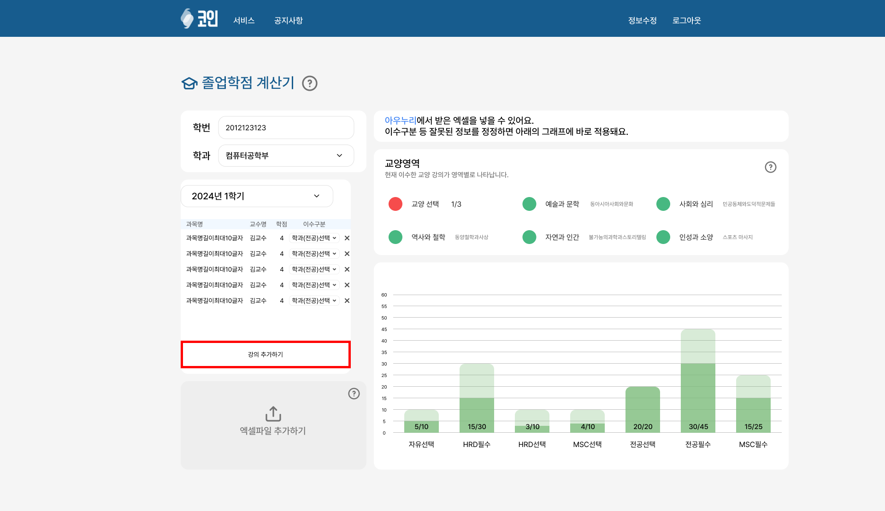

# 3-5. 졸업학점 계산기_강의 추가 (클릭)

[← 졸업학점 계산기 - 레거시 목록](README.md)

플랫폼: WEB  
원문 상태: 레거시  
[Notion 기준 명세](https://app.notion.com/p/c6c0221954bc83b9becb811945553da4)  
원본 ID: `c6c0221954bc83b9becb811945553da4`

<!-- notion-body:start -->
## 이전 로깅

- event\_label : “graduation\_calculator\_add\_lecture”
- value : “강의 추가<b>”</b>
- event\_category : “click”
- 참고 이미지
  



## 과거 리네이밍 초안 — 레거시 (현행 적용 제외)

- 분류: 레거시
- 분류일: 2026-10-15
- 레거시 사유: 현재 웹 시간표·서비스 메뉴에서 졸학계 진입점을 확인할 수 없으며, 사용자가 서비스 제거로 판단해 레거시 분류를 지시함. 현행 화면 정의·신규 리네이밍 적용 대상에서 제외하고 기존 로그·사진은 과거 참고 자료로 보존한다. 서비스 종료일·코드 전체 삭제 여부는 미확인.
- 작성일: 2026-10-14
- 보존 자료: 2026-10-14 작성 당시의 리네이밍 초안. 아래 화면명·label·검토사항은 현행 적용값이 아닌 과거 자료이며, DB 상태는 레거시로 분류한다.
- 기존 적용 플랫폼: WEB. iOS 실제 화면은 미검수.
- 설명: 졸학계에서 강의 추가하기 버튼을 클릭한다.
- screen\_view: <code>grad_calc</code>
- event\_label: <code>grad_calc__grad_calc__grad_lecture__add</code>
- event\_name: 기존 값 유지 (본문 미기재 / 수집값 확인 필요)
- value: 강의 추가
- event\_category: <code>click</code>
- 화면명 근거: [Notion 원문](https://app.notion.com/p/4129ae650b59804fbe20e3a332b84b2a). 정의 제안과 실제 전송값 검수는 별도.

### 참고사진 (기능 표시)

<b>웹(데스크톱)</b>

기존 웹 명세 캡처 사본. 현재 구현·진입 경로 미확인. 로그인 이후 UI의 기존 디자인 자료. Figma 참고 / 현재 실제 화면 미확인.


<!-- notion-body:end -->

<details>
<summary>Notion 원문 속성 전체</summary>

```json
{
  "platform": [
    "WEB"
  ],
  "url": "https://app.notion.com/p/c6c0221954bc83b9becb811945553da4",
  "구분": "졸업학점 계산기 내부",
  "상태": "레거시",
  "생성일": "2026-11-23T13:39:21.915Z",
  "이벤트 이름": "3-5. 졸업학점 계산기\\_<b>강의 추가 (클릭)</b>",
  "태그": [
    "졸업학점 계산기"
  ]
}
```

</details>
