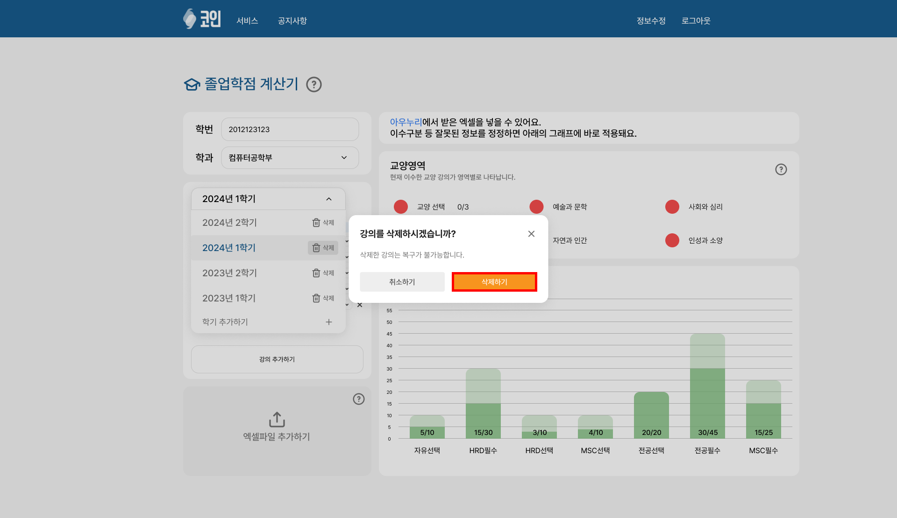

# 3-6. 졸업학점 계산기_강의 삭제 (클릭)

[← 졸업학점 계산기 - 레거시 로깅 목록](README.md)

플랫폼: WEB  
원문 상태: 레거시

과거 로깅·새 로깅과 각 참고사진은 원문의 구간별 연결을 유지합니다.

<!-- logging-section:past:start -->
## 이전 로깅

- event\_label : “graduation\_calculator\_delete\_lecture”
- value : “강의 삭제<b>”</b>
- event\_category : “click”
- 참고 이미지
  

<!-- logging-section:past:end -->

과거 리네이밍 초안 — 레거시 (현행 적용 제외)

- 분류: 레거시
- 분류일: 2026-10-15
- 레거시 사유: 현재 웹 시간표·서비스 메뉴에서 졸학계 진입점을 확인할 수 없으며, 사용자가 서비스 제거로 판단해 레거시 분류를 지시함. 현행 화면 정의·신규 리네이밍 적용 대상에서 제외하고 기존 로그·사진은 과거 참고 자료로 보존한다. 서비스 종료일·코드 전체 삭제 여부는 미확인.
- 작성일: 2026-10-14
- 보존 자료: 2026-10-14 작성 당시의 리네이밍 초안. 아래 화면명·label·검토사항은 현행 적용값이 아닌 과거 자료이며, DB 상태는 레거시로 분류한다.
- 기존 적용 플랫폼: WEB. iOS 실제 화면은 미검수.
- 설명: 졸학계의 강의 삭제 확인 팝업에서 삭제 버튼을 클릭한다.
- screen\_view: <code>grad_calc</code>
- event\_label: <code>grad_calc__grad_calc__grad_lecture__delete_confirmation</code>
- event\_name: 기존 값 유지 (본문 미기재 / 수집값 확인 필요)
- value: 강의 삭제
- event\_category: <code>click</code>

### 검토사항

- 사진은 삭제 확인 팝업의 확인 버튼이다. 강의 X 클릭과 확인 클릭 중 기존 이벤트 발생 시점 확인 필요.
- 화면명 근거: 원문 (원문 ID: 4129ae650b59804fbe20e3a332b84b2a). 정의 제안과 실제 전송값 검수는 별도.

### 참고사진 (기능 표시)

<b>웹(데스크톱)</b>

기존 웹 명세 캡처 사본. 현재 구현·진입 경로 미확인. 로그인 이후 UI의 기존 디자인 자료. Figma 참고 / 현재 실제 화면 미확인.

---

원문 정보

원본 ID: `6e00221954bc82b980a8015751e329c8`  
[보존 원문](../../_archive/original/notion/pages/6e00221954bc82b980a8015751e329c8.md)

