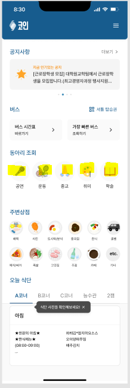
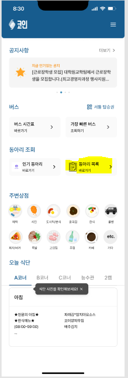
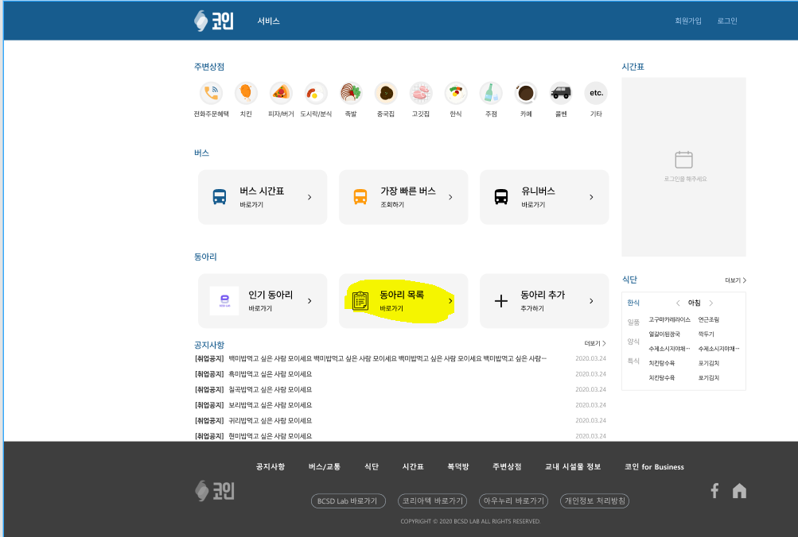

# [레거시] 1-1. 동아리_동아리 진입

[← 동아리 - 레거시 로깅 목록](README.md)

플랫폼: ANDROID · IOS · WEB  
원문 상태: 레거시

원문에 과거·새 로깅 구분이 없어 아래 정의와 참고사진을 원문 순서로 표시합니다.

원문 미기재 항목: `screen_view`. 값을 추정하지 않았습니다.

<callout icon="🗃️" color="gray_bg">
<b>레거시 — 동아리 로깅 전체 현행 적용 제외</b>

- 2026-11-04 사용자 지시로 동아리 로깅 전체를 레거시로 보존한다. 이 페이지는 신규 구현·추가 전송·새 네이밍 적용의 기준이 아니다.
- 기존 event\_name·event\_label·value·category·사진·플랫폼과 원문을 그대로 보존한다. 새 라벨을 만들거나 DA1/DA2로 재배정하지 않는다.
- 서비스 전체 기준: [동아리 - 레거시](../../_archive/original/notion/pages/1880221954bc82f98785817f02a64b99.md). 실제 SDK 수집 종료 여부는 별도 확인 대상이다.
</callout>

- 설명:  코인 메인화면에서 동아리 진입
- event\_name : “CAMPUS”
- event\_category : “click”
- event\_label : “main\_club”
- value : \{”공연”,”운동”,”종교”,”취미”,”학술”\}     - A안의 경우에만 해당
- value:  “”  - B안 화면은 값이 없음.

모바일A안 화면

모바일 B안 화면

- 웹

---

원문 정보

원본 ID: `5680221954bc822ab62e8162d5365f9e`  
[보존 원문](../../_archive/original/notion/pages/5680221954bc822ab62e8162d5365f9e.md)

