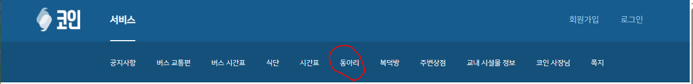

# [레거시] 1-4.동아리_헤더

[← 동아리 - 레거시 로깅 목록](README.md)

플랫폼: WEB  
원문 상태: 레거시

원문에 과거·새 로깅 구분이 없어 아래 정의와 참고사진을 원문 순서로 표시합니다.

원문 미기재 항목: `screen_view`. 값을 추정하지 않았습니다.

<callout icon="🗃️" color="gray_bg">
<b>레거시 — 동아리 로깅 전체 현행 적용 제외</b>

- 2026-11-04 사용자 지시로 동아리 로깅 전체를 레거시로 보존한다. 이 페이지는 신규 구현·추가 전송·새 네이밍 적용의 기준이 아니다.
- 기존 event\_name·event\_label·value·category·사진·플랫폼과 원문을 그대로 보존한다. 새 라벨을 만들거나 DA1/DA2로 재배정하지 않는다.
- 서비스 전체 기준: [동아리 - 레거시](../../_archive/original/notion/pages/1880221954bc82f98785817f02a64b99.md). 실제 SDK 수집 종료 여부는 별도 확인 대상이다.
</callout>

- 설명:  코인 웹 헤더에서 동아리 진입
- event\_name : “CAMPUS”
- event\_category : “click”
- event\_label : “header”
- value :”동아리”
- 웹

### 참고사진 (커뮤니티 → 동아리 · WEB 리디자인)

<b>웹</b>

참고사진 · 웹 — 새 명세 미확정

커뮤니티 → 동아리. 출처: [Figma WEB 리디자인](https://www.figma.com/design/DPlcYuiFxhyT5ULbqec59i/KOIN-Web?node-id=11541-33352), 2026-11-04 원본 캡처에 코드로 빨간 네모만 추가. 기존 동아리 헤더 동작의 위치 참고사진이다. 새 네이밍 명세·담당자 확정은 미확인이며 새 라벨이나 추가 전송을 만들지 않았다.

---

원문 정보

원본 ID: `0ca0221954bc82b0898781758b1df4ff`  
[보존 원문](../../_archive/original/notion/pages/0ca0221954bc82b0898781758b1df4ff.md)

