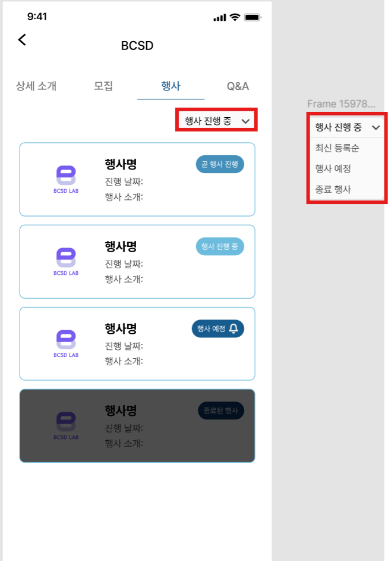
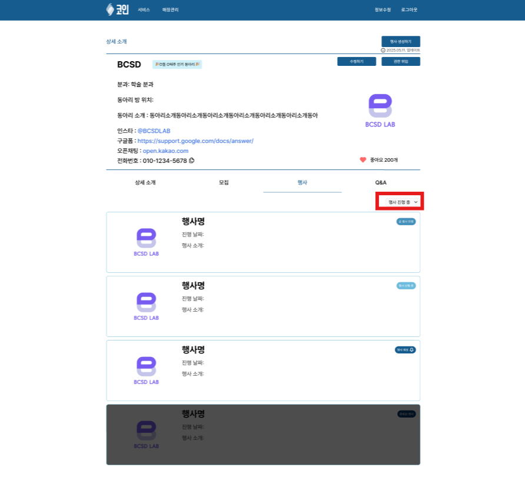

# [레거시] 6.2동아리_행사필터 클릭

[← 동아리 - 레거시 목록](README.md)

플랫폼: ANDROID, IOS, WEB  
원문 상태: 레거시  
[Notion 기준 명세](https://app.notion.com/p/39a0221954bc837eb48a812a0b716c4e)  
원본 ID: `39a0221954bc837eb48a812a0b716c4e`

<!-- notion-body:start -->
<b>레거시 — 동아리 로깅 전체 현행 적용 제외</b>

- 2026-11-04 사용자 지시로 동아리 로깅 전체를 레거시로 보존한다. 이 페이지는 신규 구현·추가 전송·새 네이밍 적용의 기준이 아니다.
- 기존 event\_name·event\_label·value·category·사진·플랫폼과 원문을 그대로 보존한다. 새 라벨을 만들거나 DA1/DA2로 재배정하지 않는다.
- 서비스 전체 기준: [동아리 - 레거시](https://app.notion.com/p/f2b0221954bc8289af3f812cfbbe9ca8). 실제 SDK 수집 종료 여부는 별도 확인 대상이다.

- 설명: 동아리 행사 화면에서 드롭다운 형식의 필터 중 하나를 클릭
- event\_name : “CAMPUS”
- event\_label : “club\_event\_filter”
- value : (”행사 진행 중”, “최신 등록순”, “행사 예정”, “종료 행사”)
- event\_category : “click”
- 참고사진



- 웹 참고사진


<!-- notion-body:end -->

<details>
<summary>Notion 원문 속성 전체</summary>

```json
{
  "platform": [
    "ANDROID",
    "IOS",
    "WEB"
  ],
  "url": "https://app.notion.com/p/39a0221954bc837eb48a812a0b716c4e",
  "상태": "레거시",
  "이름": "\\[레거시\\] 6.2동아리\\_행사필터 클릭",
  "태그": [
    "6.동아리_행사"
  ]
}
```

</details>
