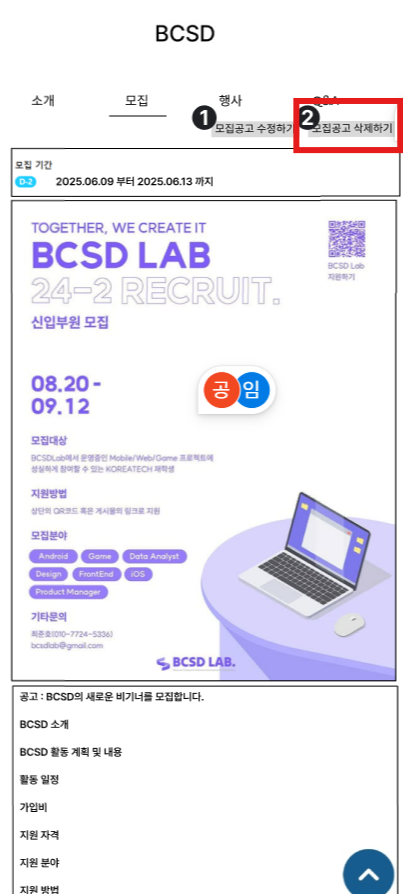
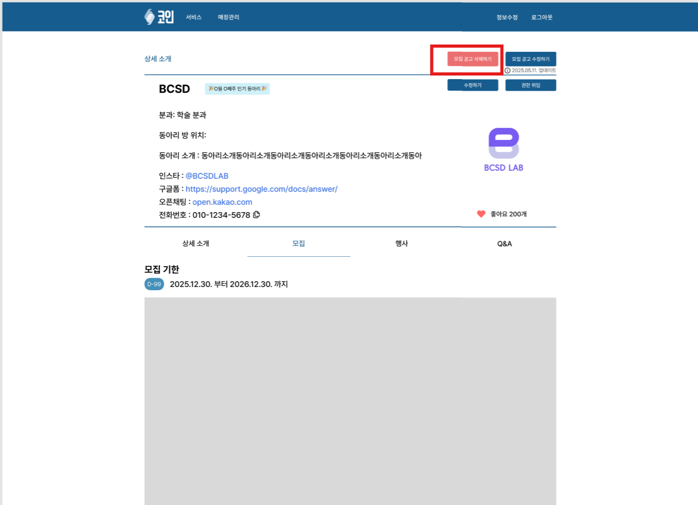

# [레거시] [레거시] 7.7동아리_모집삭제 클릭

> **레거시 문서** · 과거 구현과 로깅을 확인하기 위한 보존 자료입니다.

[← 동아리 - 레거시 로깅 목록](README.md)

플랫폼: WEB · ANDROID · IOS  
원문 상태: 레거시

원문에 과거·새 로깅 구분이 없어 아래 정의와 참고사진을 원문 순서로 표시합니다.

원문 미기재 항목: `screen_view`. 값을 추정하지 않았습니다.

<callout icon="🗃️" color="gray_bg">
<b>레거시 — 동아리 로깅 전체 현행 적용 제외</b>

- 2026-11-04 사용자 지시로 동아리 로깅 전체를 레거시로 보존한다. 이 페이지는 신규 구현·추가 전송·새 네이밍 적용의 기준이 아니다.
- 기존 event\_name·event\_label·value·category·사진·플랫폼과 원문을 그대로 보존한다. 새 라벨을 만들거나 DA1/DA2로 재배정하지 않는다.
- 서비스 전체 기준: [동아리 - 레거시](../../_archive/original/notion/pages/1880221954bc82f98785817f02a64b99.md). 실제 SDK 수집 종료 여부는 별도 확인 대상이다.
</callout>

- 설명: 동아리 모집 탭에서 모집 공고 삭제하기 클릭

- event\_name : “CAMPUS”

- event\_label : “club\_recruitment\_delete”

- value : \{동아리명\}

- event\_category : “click” 

- 참고사진(디자인이 안나와 불가피하게 앱 기능 정의서로 대체하겠습니다..!)

- 웹 참고사진

---

원문 정보

원본 ID: `c340221954bc82b0b6b00163548af156`  
[보존 원문](../../_archive/original/notion/pages/c340221954bc82b0b6b00163548af156.md)

