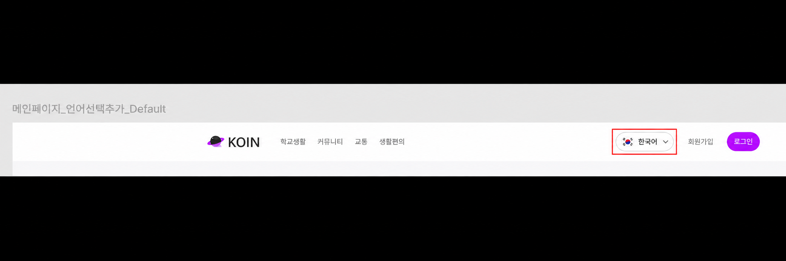

# 1-1-1 언어 메뉴 열기 클릭 (웹)

[← 다국어 지원 로깅 목록](README.md)

- 플랫폼: WEB
- 상태: 로깅 필요

상태: 명세 초안 · SDK 구현·배포·실수집 미확인

## 새 로깅 (26.11.16)

- 설명: 홈 화면 헤더의 현재 언어 선택 버튼을 클릭해 닫혀 있던 언어 목록 메뉴를 열 때 1회 기록한다.
- screen\_view: <code>main</code>
- event\_name: <code>DA1</code>
- event\_label: <code>main__main__language_setting__entry__click</code>
- value: 언어 설정
- event\_category: <code>click</code>

### 참고사진 (홈 언어 메뉴 열기)

<b>웹</b>

<b>참고사진 · 웹</b>

사용자 제공 웹 홈 디자인을 편집해 빨간 네모로 언어 메뉴 버튼을 표시했다. 실기기·SDK 검증 사진은 아니다. 모바일 웹 대응 여부는 별도 확인한다.

<b>앱</b>

홈 화면에서 같은 언어 메뉴를 제공하는지와 해당 앱 이미지는 미확인이다. 기존 앱 설정 화면 사진을 홈 사진으로 대신 표시하지 않는다.

