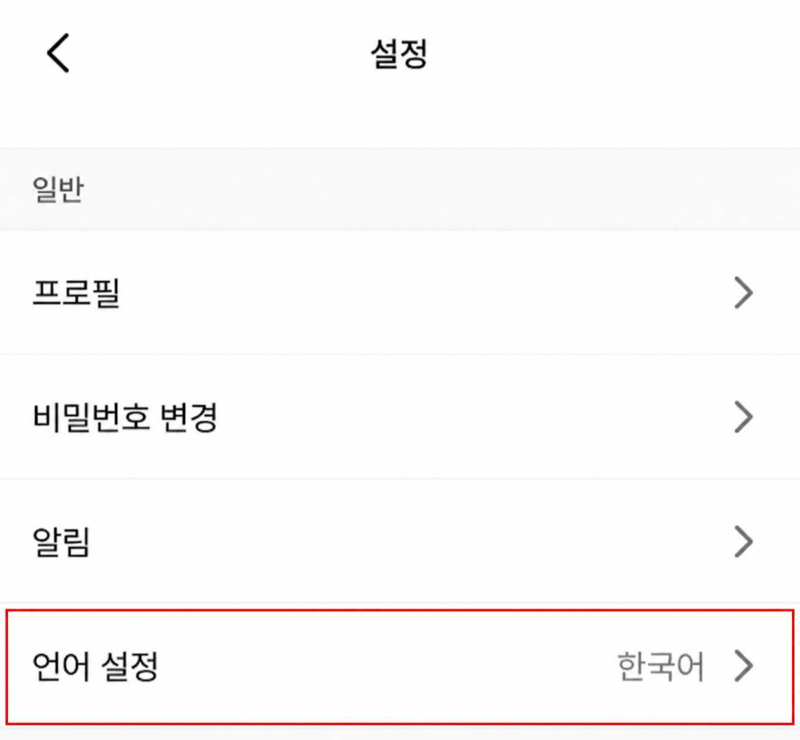

# 1-1 언어 설정 진입 클릭 (모바일)

[← 다국어 지원 로깅 목록](README.md)

- 플랫폼: ANDROID · IOS · WEB(모바일)
- 상태: 로깅 필요

상태: 명세 초안 · 적용 플랫폼 및 SDK 구현·배포·실수집 미확인

## 새 로깅 (26.11.16)

- 설명: 설정 화면의 언어 설정 행을 클릭해 언어 선택 화면으로 이동을 요청할 때 1회 기록한다.
- screen\_view: <code>account_config</code>
- event\_name: <code>DA1</code>
- event\_label: <code>account__account_config__language_setting__entry__click</code>
- value: 언어 설정
- event\_category: <code>click</code>

### 참고사진 (언어 설정 행)

<b>앱</b>

앱 — 사용자 제공 앱 디자인에 빨간 네모를 표시한 참고사진이다. iOS·Android 각각의 SDK 구현·배포·실수집 검증은 미확인이다.

