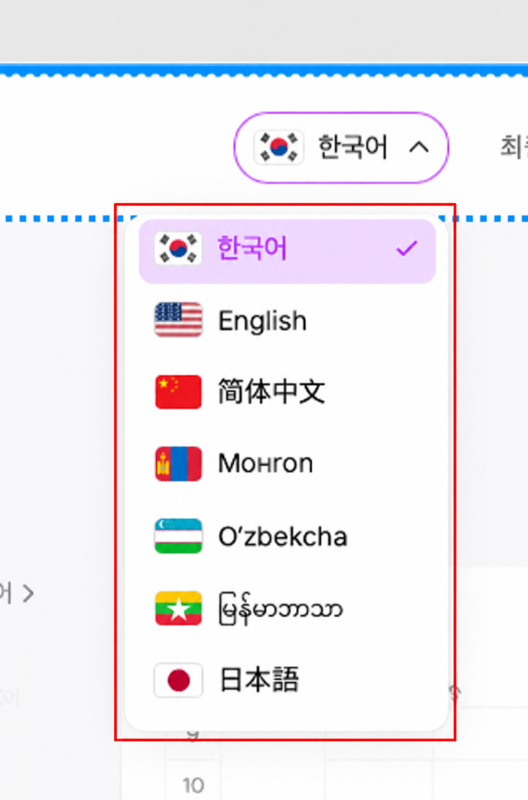

# 1-2 언어 선택 (웹)

[← 다국어 지원 로깅 목록](README.md)

- 플랫폼: WEB
- 상태: 로깅 필요

상태: 명세 초안 · SDK 구현·배포·실수집 미확인

## 새 로깅 (26.11.16)

- 설명: 홈 화면 헤더에서 열린 언어 목록의 항목을 눌러 현재 선택과 다른 언어로 유효한 변경 선택이 받아들여질 때 1회 기록한다.
- screen\_view: <code>main</code>
- event\_name: <code>DA1</code>
- event\_label: <code>main__main__language_setting__select</code>
- value: \{선택한 언어\} (예: 한국어, English)
- event\_category: <code>select</code>

### 전송 기준

value 허용값은 한국어 / 영어 / 중국어간체 / 몽골어 / 우즈베크어 / 미얀마어 / 일본어다. 초기 기본값 표시·자동 언어 적용·이미 선택된 언어 재선택은 제외한다. 표시된 English 등 현지화 문구 대신 표준값 영어 등을 전송한다. 선택 이벤트가 저장 성공을 의미하지는 않는다.

설정 화면(account\_config / language\_setting)의 언어 설정과 동작 위치가 달라 별도 계약으로 정의한다. 웹·앱의 같은 계약은 같은 필드·라벨·value 표준값을 사용하며, 실제 지원하는 화면에서만 전송한다.

### 참고사진 (홈 언어 선택)

<b>웹</b>

<b>참고사진 · 웹</b>

사용자 제공 웹 홈 디자인을 편집해 빨간 네모로 언어 선택 목록을 표시했다. 실기기·SDK 검증 사진은 아니다. 모바일 웹 대응 여부는 별도 확인한다.

<b>앱</b>

홈 화면에서 같은 언어 메뉴를 제공하는지와 해당 앱 이미지는 미확인이다. 기존 앱 설정 화면 사진을 홈 사진으로 대신 표시하지 않는다.

