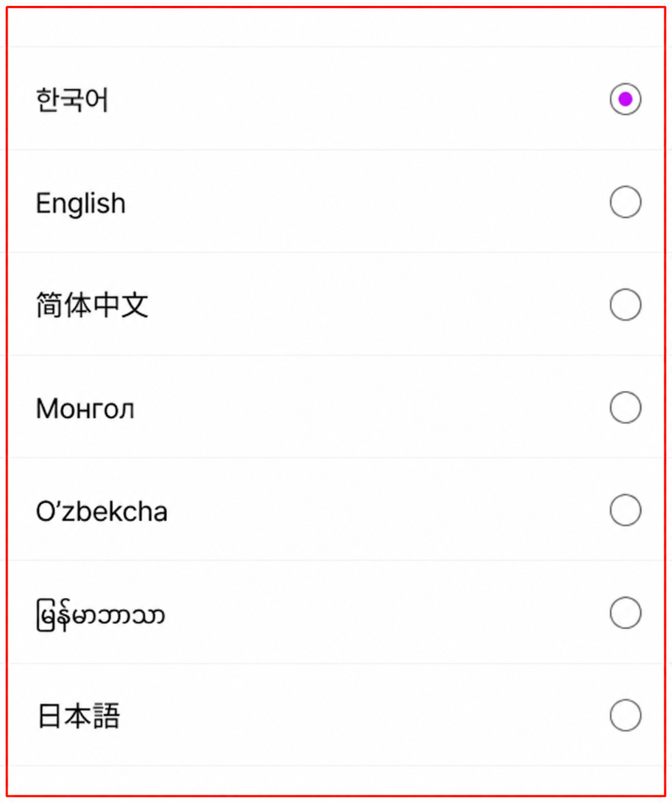

# 1-2 언어 선택 (모바일)

[← 다국어 지원 목록](README.md)

플랫폼: ANDROID, IOS, WEB(모바일)  
원문 상태: 로깅 필요  
[Notion 기준 명세](https://app.notion.com/p/0800221954bc82bd90db811323f5b7c2)  
원본 ID: `0800221954bc82bd90db811323f5b7c2`

<!-- notion-body:start -->
상태: 명세 초안 · 적용 플랫폼 및 SDK 구현·배포·실수집 미확인

## 새 로깅 (26.11.16)

- 설명: 언어 선택 목록에서 현재 선택과 다른 언어를 눌러 유효한 변경 선택이 받아들여질 때 1회 기록한다.
- screen\_view: <code>language_setting</code>
- event\_name: <code>DA1</code>
- event\_label: <code>account__language_setting__language_setting__select</code>
- value: \{선택한 언어\} (예: 영어)
- event\_category: <code>select</code>

### 참고사진 (언어 선택 목록)

<b>앱</b>

앱 — 사용자 제공 앱 디자인에 빨간 네모를 표시한 참고사진이다. iOS·Android 각각의 SDK 구현·배포·실수집 검증은 미확인이다.


언어 선택 목록 · 빨간 네모 표시
<!-- notion-body:end -->

<details>
<summary>Notion 원문 속성 전체</summary>

```json
{
  "platform": [
    "ANDROID",
    "IOS",
    "WEB(모바일)"
  ],
  "url": "https://app.notion.com/p/0800221954bc82bd90db811323f5b7c2",
  "상태": "로깅 필요",
  "이름": "1-2 언어 선택 (모바일)"
}
```

</details>
