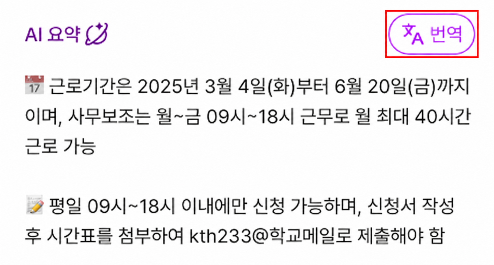
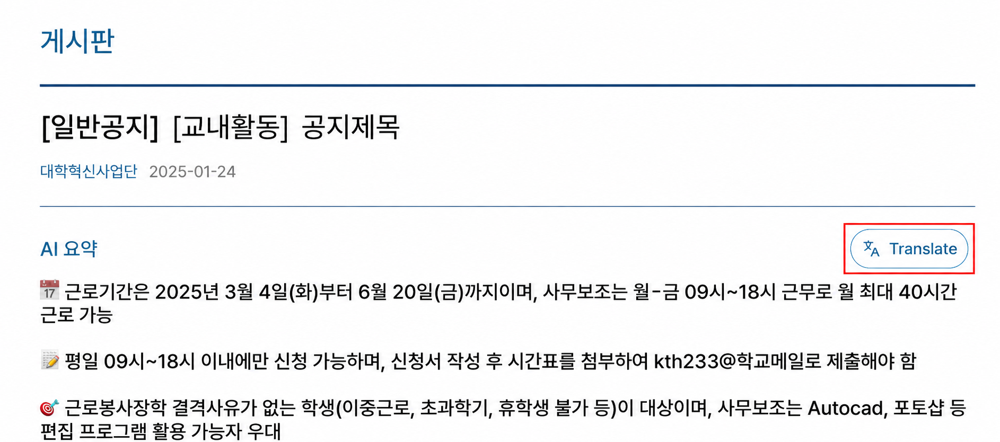

# 2-1 공지사항 번역 클릭

[← 다국어 지원 로깅 목록](README.md)

- 플랫폼: ANDROID · IOS · WEB · WEB(모바일)
- 상태: 로깅 필요

상태: 명세 초안 · 적용 플랫폼 및 SDK 구현·배포·실수집 미확인

## 새 로깅 (26.11.16)

- 설명: 공지사항 상세의 AI 요약 영역에서 활성화된 번역 버튼을 클릭해 번역 요청을 시작할 때 1회 기록한다.
- screen\_view: <code>notice_detail</code>
- event\_name: <code>DA1</code>
- event\_label: <code>board__notice_detail__translation__request__click</code>
- value: 번역
- event\_category: <code>click</code>

### 참고사진 (AI 요약 번역 버튼)

<b>앱</b>

앱 — 사용자 제공 앱 디자인 참고사진이다. 빨간 네모 = 클릭 위치. iOS·Android 각각의 SDK 구현·수집은 미확인이다.

### 참고사진 · 웹

웹 — 공지사항 AI 요약 번역 버튼. 사용자 제공 웹 디자인의 Translate 버튼을 빨간 네모로 표시했다. 실제 SDK 구현·수집 검증 사진은 아니다.

