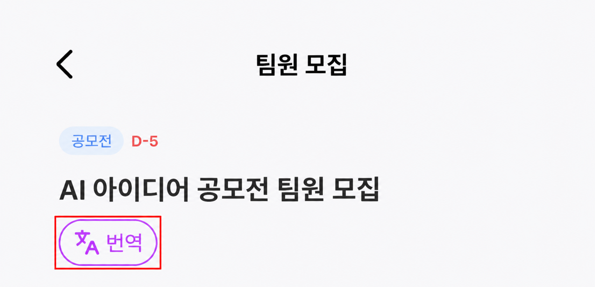
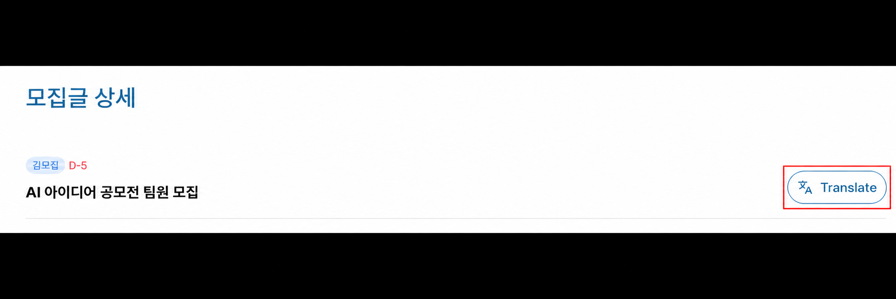

# 4-1 팀원모집 번역 클릭

[← 다국어 지원 목록](README.md)

플랫폼: ANDROID, IOS, WEB, WEB(모바일)  
원문 상태: 로깅 필요  
[Notion 기준 명세](https://app.notion.com/p/e4d0221954bc83a59aa1015e5a077191)  
원본 ID: `e4d0221954bc83a59aa1015e5a077191`

<!-- notion-body:start -->
상태: 명세 초안 · 적용 플랫폼 및 SDK 구현·배포·실수집 미확인

## 새 로깅 (26.11.16)

- 설명: 팀원모집 상세 화면의 활성화된 번역 버튼을 클릭해 해당 모집글의 번역 요청을 시작할 때 1회 기록한다.
- screen\_view: <code>team_detail</code>
- event\_name: <code>DA1</code>
- event\_label: <code>team_recruit__team_detail__translation__request__click</code>
- value: 번역
- event\_category: <code>click</code>

### 참고사진 (팀원모집 번역 버튼)

<b>앱</b>

앱 — 사용자 제공 앱 디자인에 빨간 네모를 표시한 참고사진이다. iOS·Android 각각의 SDK 구현·배포·실수집 검증은 미확인이다.


팀원모집 번역 버튼 · 빨간 네모 표시

### 참고사진 · 웹

웹 — 사용자 제공 웹 디자인을 편집해 클릭 위치에 빨간 네모를 표시했다. 실제 SDK 구현·수집 검증 사진은 아니다.


웹 · 4-1 팀원모집 번역 클릭 · 빨간 네모 표시
<!-- notion-body:end -->

<details>
<summary>Notion 원문 속성 전체</summary>

```json
{
  "platform": [
    "ANDROID",
    "IOS",
    "WEB",
    "WEB(모바일)"
  ],
  "url": "https://app.notion.com/p/e4d0221954bc83a59aa1015e5a077191",
  "상태": "로깅 필요",
  "이름": "4-1 팀원모집 번역 클릭"
}
```

</details>
