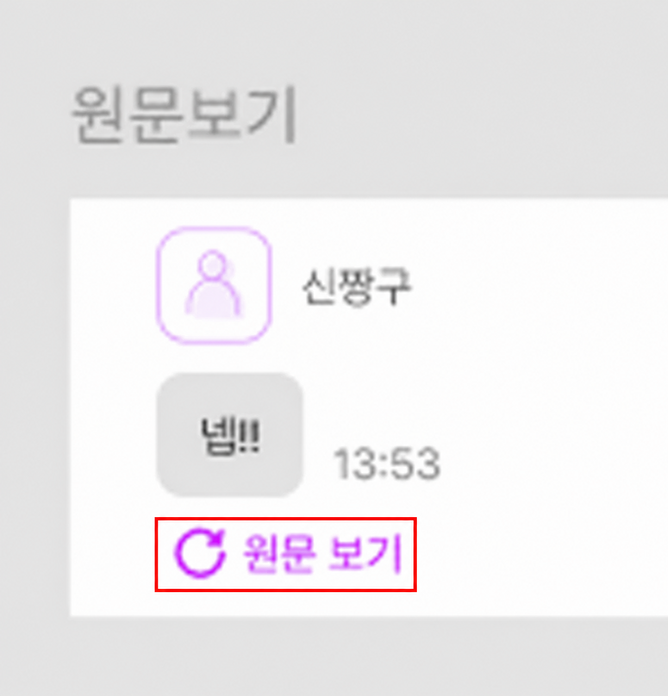
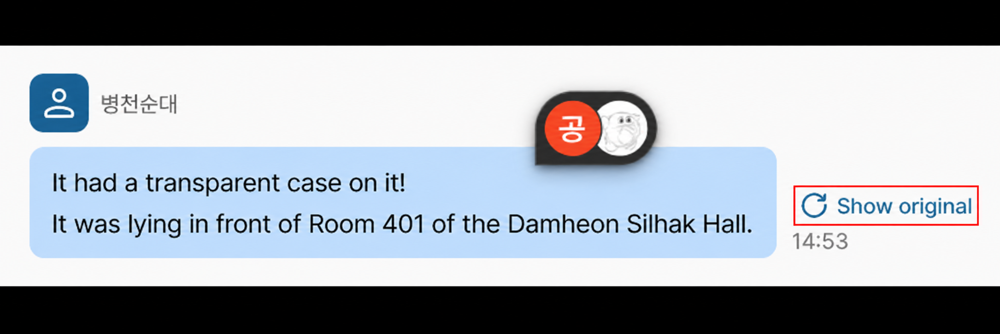

# 5-2 콜밴팟 메시지 원문보기 클릭

[← 다국어 지원 목록](README.md)

플랫폼: ANDROID, IOS, WEB, WEB(모바일)  
원문 상태: 로깅 필요  
[Notion 기준 명세](https://app.notion.com/p/35f0221954bc825aa5d0018b569a4cf5)  
원본 ID: `35f0221954bc825aa5d0018b569a4cf5`

<!-- notion-body:start -->
상태: 명세 초안 · 적용 플랫폼 및 SDK 구현·배포·실수집 미확인

## 새 로깅 (26.11.16)

- 설명: 콜밴팟 채팅에서 번역된 개별 메시지 아래의 원문보기 버튼을 클릭해 그 메시지의 원문으로 되돌릴 때 1회 기록한다.
- screen\_view: <code>callvan_chat</code>
- event\_name: <code>DA1</code>
- event\_label: <code>callvan__callvan_chat__translation__original__click</code>
- value: 원문보기
- event\_category: <code>click</code>

### 참고사진 (개별 메시지 원문보기 버튼)

<b>앱</b>

앱 — 사용자 제공 앱 디자인에 빨간 네모를 표시한 참고사진이다. iOS·Android 각각의 SDK 구현·배포·실수집 검증은 미확인이다.


개별 메시지 원문보기 버튼 · 빨간 네모 표시

### 참고사진 · 웹

웹 — 사용자 제공 웹 디자인을 편집해 클릭 위치에 빨간 네모를 표시했다. 실제 SDK 구현·수집 검증 사진은 아니다.


웹 · 5-2 콜밴팟 메시지 원문보기 클릭 · 빨간 네모 표시
<!-- notion-body:end -->

<details>
<summary>Notion 원문 속성 전체</summary>

```json
{
  "platform": [
    "ANDROID",
    "IOS",
    "WEB",
    "WEB(모바일)"
  ],
  "url": "https://app.notion.com/p/35f0221954bc825aa5d0018b569a4cf5",
  "상태": "로깅 필요",
  "이름": "5-2 콜밴팟 메시지 원문보기 클릭"
}
```

</details>
