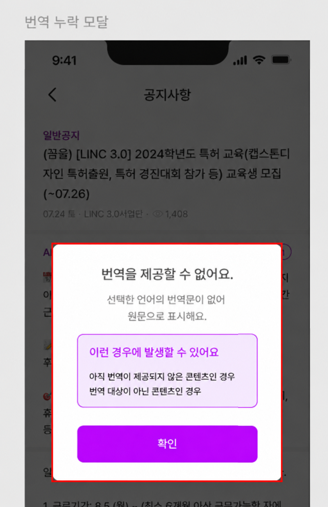
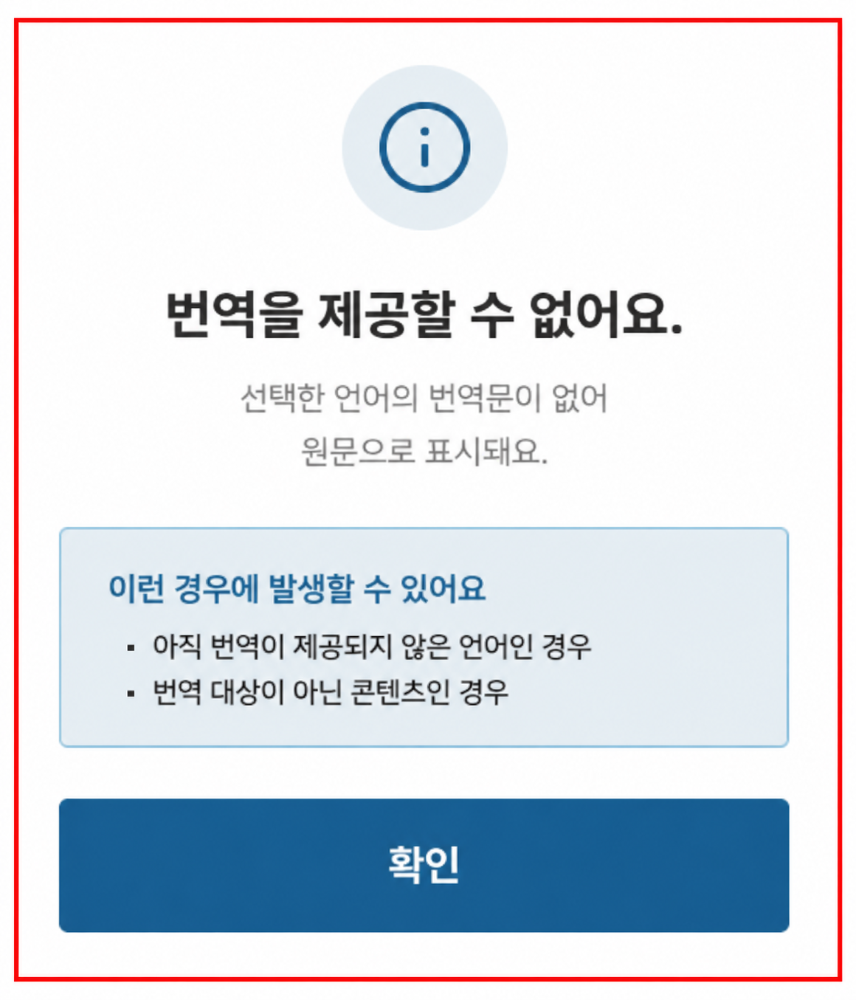

# 6-1 번역 미제공 안내 노출 (공지사항)

[← 다국어 지원 목록](README.md)

플랫폼: ANDROID, IOS, WEB, WEB(모바일)  
원문 상태: 로깅 필요  
[Notion 기준 명세](https://app.notion.com/p/f9d0221954bc83e39f7c01747531c714)  
원본 ID: `f9d0221954bc83e39f7c01747531c714`

<!-- notion-body:start -->
상태: 명세 초안 · 적용 플랫폼 및 SDK 구현·배포·실수집 미확인

## 새 로깅 (26.11.16)

- 설명: 공지사항 상세에서 번역을 제공할 수 없어요 안내 모달이 실제 화면에 표시될 때 모달이 열린 회차당 1회 기록한다.
- screen\_view: <code>notice_detail</code>
- event\_name: <code>DA1</code>
- event\_label: <code>board__notice_detail__translation__unavailable__exposure</code>
- value: 번역미제공
- event\_category: <code>exposure</code>

### 참고사진 (번역 미제공 안내 모달)

<b>앱</b>

앱 — 사용자 제공 앱 디자인에 빨간 네모를 표시한 참고사진이다. iOS·Android 각각의 SDK 구현·배포·실수집 검증은 미확인이다.


번역 미제공 안내 모달 · 빨간 네모 표시

### 참고사진 · 웹

웹 — 사용자 제공 웹 디자인을 편집해 안내 영역에 빨간 네모를 표시했다. 실제 SDK 구현·수집 검증 사진은 아니다.


웹 · 6-2 번역 미제공 안내 노출 (공지사항) · 빨간 네모 표시
<!-- notion-body:end -->

<details>
<summary>Notion 원문 속성 전체</summary>

```json
{
  "platform": [
    "ANDROID",
    "IOS",
    "WEB",
    "WEB(모바일)"
  ],
  "url": "https://app.notion.com/p/f9d0221954bc83e39f7c01747531c714",
  "상태": "로깅 필요",
  "이름": "6-1 번역 미제공 안내 노출 (공지사항)"
}
```

</details>
