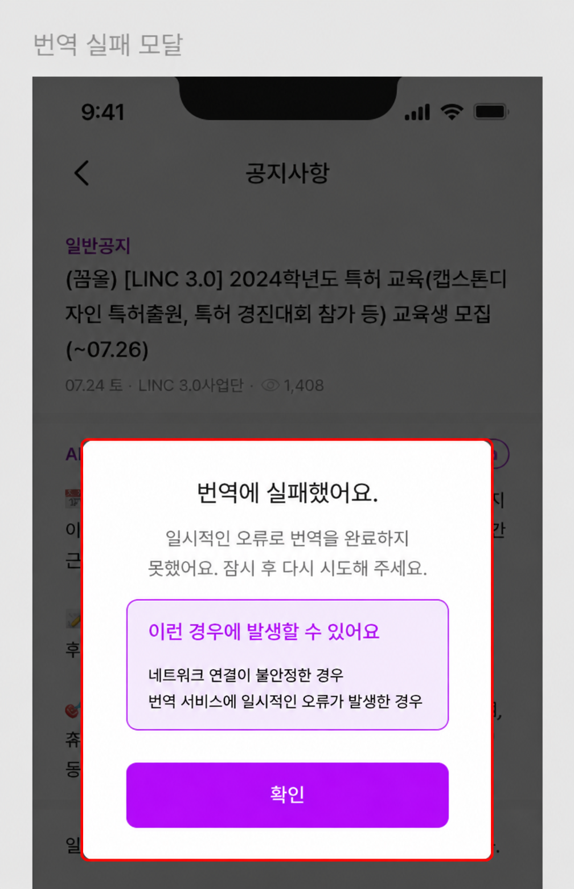
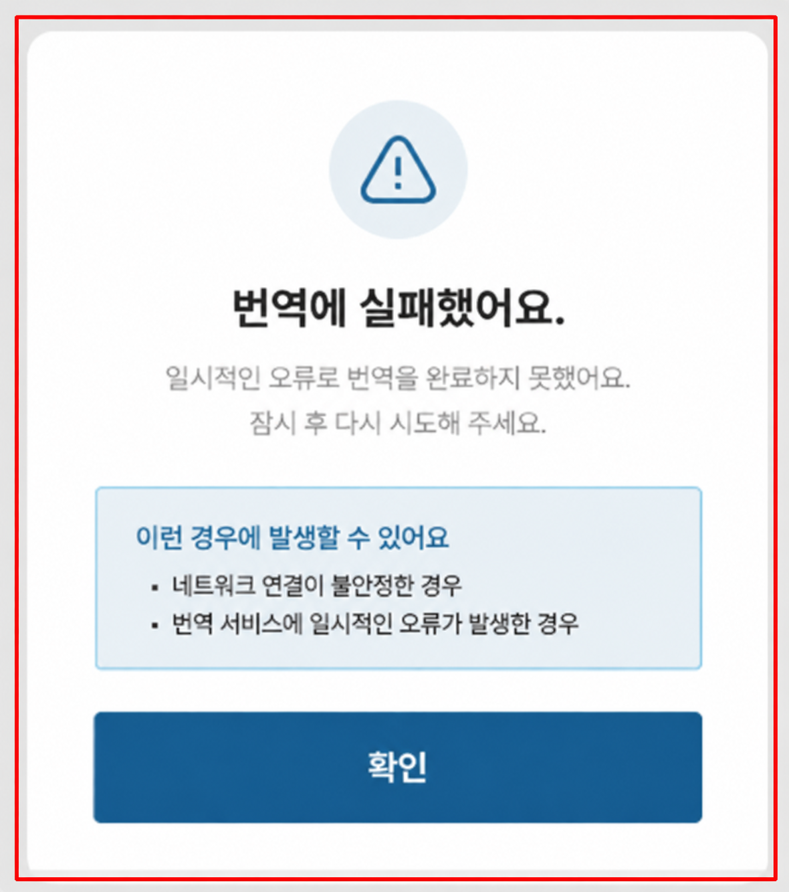

# 6-2 번역 실패 안내 노출 (공지사항)

[← 다국어 지원 로깅 목록](README.md)

- 플랫폼: ANDROID · IOS · WEB · WEB(모바일)
- 상태: 로깅 필요

상태: 명세 초안 · 적용 플랫폼 및 SDK 구현·배포·실수집 미확인

## 새 로깅 (26.11.16)

- 설명: 공지사항 상세에서 일시적 오류로 번역에 실패했어요 안내 모달이 실제 화면에 표시될 때 모달이 열린 회차당 1회 기록한다.
- screen\_view: <code>notice_detail</code>
- event\_name: <code>DA1</code>
- event\_label: <code>board__notice_detail__translation__error__exposure</code>
- value: 번역실패
- event\_category: <code>exposure</code>

### 참고사진 (번역 실패 안내 모달)

<b>앱</b>

앱 — 사용자 제공 앱 디자인에 빨간 네모를 표시한 참고사진이다. iOS·Android 각각의 SDK 구현·배포·실수집 검증은 미확인이다.

### 참고사진 · 웹

웹 — 사용자 제공 웹 디자인을 편집해 안내 영역에 빨간 네모를 표시했다. 실제 SDK 구현·수집 검증 사진은 아니다.

