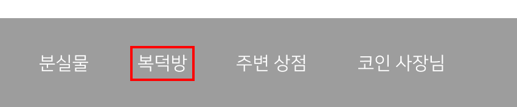

# [레거시] 1-1 헤더_복덕방 진입(클릭)

[← 레거시 복덕방 목록](README.md)

> 레거시 참고 명세입니다. 현행 구현·신규 전송의 기준으로 사용하지 않습니다.

생성일: 2026년 11월 17일 오전 9:59
platform: WEB
상태: 완료

- 과거 로깅
    
    event_params.key
    
    - event_label : header
    - value : 복덕방
    - event_category : click
- 새 로깅
    - 설명: 웹 상단 헤더의 서비스 메뉴에서 복덕방을 클릭해 복덕방 목록 화면으로 들어가는 경우
    - screen_view: `header`
    - event_name: `DA1`
    - event_label: `real_estate__header__real_estate_entry__header_entry__click`
    - value: 복덕방
    - event_category: `click`
    
    ### 참고사진 (생활편의 → 복덕방 · WEB 리디자인)
    
    **웹**
    
    **참고사진 · 웹**
    
    생활편의 → 복덕방. 출처: [Figma WEB 리디자인](https://www.figma.com/design/DPlcYuiFxhyT5ULbqec59i/KOIN-Web?node-id=11541-33352), 2026년 11월 4일 원본 캡처에 코드로 빨간 네모만 추가. 빨간 네모는 기존 명세가 지칭하는 클릭 대상이다. 실제 클릭 가능 여부·SDK 적용·배포·수집은 미확인이다.
    
    