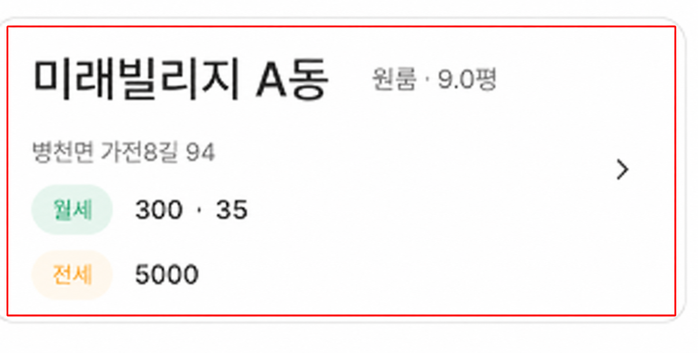
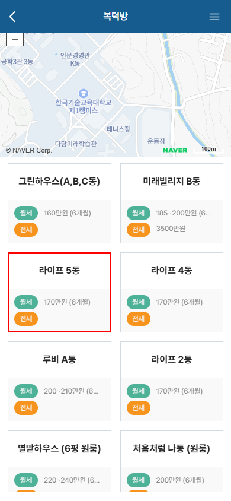

# 2-1 복덕방 목록_방 카드 (클릭) - 추가된 로깅

[← 복덕방 (레거시) 목록](README.md)

플랫폼: ANDROID, IOS, WEB  
원문 상태: 로깅 필요  
[Notion 기준 명세](https://app.notion.com/p/f3f0221954bc83d0b49d81a68a5988ff)  
원본 ID: `f3f0221954bc83d0b49d81a68a5988ff`

<!-- notion-body:start -->
## 과거 로깅

- 없음 (새로 추가한 로깅)

## 새 로깅

- 설명: 복덕방 목록 화면에서 방 카드를 클릭해 복덕방 상세 화면으로 들어가는 경우
- screen\_view: <code>room_list</code>
- event\_name: <code>DA1</code>
- event\_label: <code>real_estate__room_list__room_detail__entry__click</code>
- value: \{방 이름\} (예: 금실타운)
- event\_category: <code>click</code>

### 참고사진 (방 카드)

<b>웹</b>

<b>참고사진 · 웹</b>

사용자 제공 복덕방 WEB 리디자인의 방 카드다. 목록 내 카드 본문·건물명·오른쪽 화살표가 같은 매물 상세 진입을 수행하면 모두 이 명세 하나로 기록한다. 한 클릭에 추가 이벤트를 병행 전송하지 않는다. value는 선택한 공개 방 이름을 유지한다. 앱 구현·SDK 배포·실수집 검증 사진은 아니다.


웹 — 빨간 네모가 이 명세의 클릭 대상이다. 같은 화면의 다른 동작은 표시하지 않았다. 사용자 제공 WEB 디자인을 편집한 참고사진이며 실기기·SDK 검증 사진은 아니다.

<b>모바일</b>

<b>참고사진 · 모바일</b>


모바일 웹 · 운영 [https://koreatech.in/room](https://koreatech.in/room) 실제 파란색 화면을 2026-10-30에 캡처. 빨간 테두리: 라이프 5동 방 카드. Android/iOS 네이티브 앱 캡처가 아니며 SDK 발화·한 번 전송은 미확인.
<!-- notion-body:end -->

<details>
<summary>Notion 원문 속성 전체</summary>

```json
{
  "platform": [
    "ANDROID",
    "IOS",
    "WEB"
  ],
  "url": "https://app.notion.com/p/f3f0221954bc83d0b49d81a68a5988ff",
  "상태": "로깅 필요",
  "생성일": "2026-11-23T13:39:24.075Z",
  "이벤트 이름": "2-1 복덕방 목록\\_방 카드 (클릭) - 추가된 로깅"
}
```

</details>
