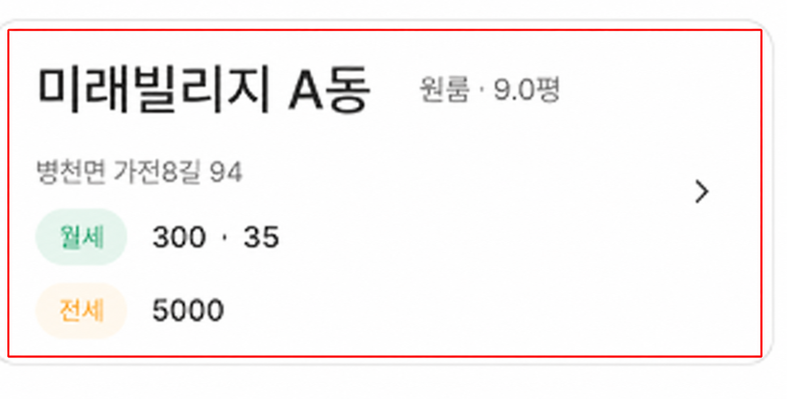

# [레거시] 2-1 복덕방 목록_방 카드 (클릭) - 추가된 로깅

[← 레거시 복덕방 목록](README.md)

> 레거시 참고 명세입니다. 현행 구현·신규 전송의 기준으로 사용하지 않습니다.

생성일: 2026년 11월 17일 오전 9:59
platform: ANDROID, IOS, WEB
상태: 로깅 필요

- 과거 로깅
    - 없음 (새로 추가한 로깅)
- 새 로깅
    - 설명: 복덕방 목록 화면에서 방 카드를 클릭해 복덕방 상세 화면으로 들어가는 경우
    - screen_view: `room_list`
    - event_name: `DA1`
    - event_label: `real_estate__room_list__room_detail__entry__click`
    - value: {방 이름} (예: 금실타운)
    - event_category: `click`
    
    ### 참고사진 (방 카드)
    
    **웹**
    
    **참고사진 · 웹**
    
    사용자 제공 복덕방 WEB 리디자인의 방 카드다. 목록 내 카드 본문·건물명·오른쪽 화살표가 같은 매물 상세 진입을 수행하면 모두 이 명세 하나로 기록한다. 한 클릭에 추가 이벤트를 병행 전송하지 않는다. value는 선택한 공개 방 이름을 유지한다. 앱 구현·SDK 배포·실수집 검증 사진은 아니다.
    
    
    
    웹 — 빨간 네모가 이 명세의 클릭 대상이다. 같은 화면의 다른 동작은 표시하지 않았다. 사용자 제공 WEB 디자인을 편집한 참고사진이며 실기기·SDK 검증 사진은 아니다.
    
    **모바일**
    
    **참고사진 · 모바일**
    
     실제 파란색 화면을 2026년 10월 30일에 캡처. 빨간 테두리: 라이프 5동 방 카드. Android/iOS 네이티브 앱 캡처가 아니며 SDK 발화·한 번 전송은 미확인.](../../assets/b97c7882-fac9-49f8-b5c3-5612a5ef2df3.png)
    
    모바일 웹 · 운영 [https://koreatech.in/room](https://koreatech.in/room) 실제 파란색 화면을 2026년 10월 30일에 캡처. 빨간 테두리: 라이프 5동 방 카드. Android/iOS 네이티브 앱 캡처가 아니며 SDK 발화·한 번 전송은 미확인.