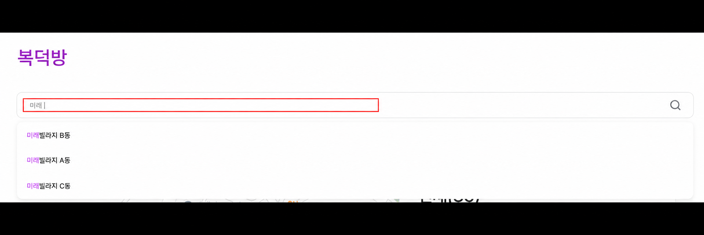

# [레거시] 2-2 복덕방 목록_검색창 클릭

[← 레거시 복덕방 목록](README.md)

> 레거시 참고 명세입니다. 현행 구현·신규 전송의 기준으로 사용하지 않습니다.

생성일: 2026년 11월 17일 오전 9:59
platform: WEB
상태: 로깅 필요

상태: 명세 초안 · 사용자 제공 WEB 디자인 기준. SDK 구현·배포·실수집 미확인.

## 새 로깅 (26.11.17)

- 설명: 복덕방 검색 입력창을 사용자가 클릭해 입력을 시작하려고 할 때 클릭 1회당 기록한다.
- screen_view: `room_list`
- event_name: `DA1`
- event_label: `real_estate__room_list__search_input__click`
- value: 검색창
- event_category: `click`

### 전송 기준

코드로 자동 포커스를 주거나 화면을 다시 그리는 경우는 제외한다. 검색 실행이나 검색 성공을 의미하지 않는다. 검색어 원문은 전송하지 않는다.

### 참고사진

**웹**

**참고사진 · 웹**

사용자 제공 복덕방 WEB 리디자인 참고 이미지다. 실기기·SDK 검증 사진이 아니며 앱 화면으로 분류하지 않는다.

웹 — 빨간 네모가 이 명세의 클릭 대상이다. 같은 화면의 다른 동작은 표시하지 않았다. 사용자 제공 WEB 디자인을 편집한 참고사진이며 실기기·SDK 검증 사진은 아니다.