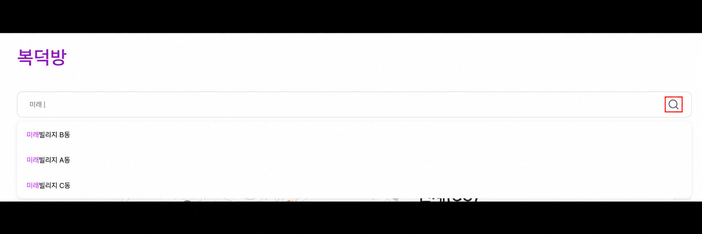

# 2-3 복덕방 목록_검색 실행

[← 복덕방 (레거시) 목록](README.md)

플랫폼: WEB  
원문 상태: 로깅 필요  
[Notion 기준 명세](https://app.notion.com/p/27b0221954bc83d480fd812c1a61717e)  
원본 ID: `27b0221954bc83d480fd812c1a61717e`

<!-- notion-body:start -->
상태: 명세 초안 · 사용자 제공 WEB 디자인 기준. SDK 구현·배포·실수집 미확인.

## 새 로깅 (26.11.17)

- 설명: 복덕방 검색창에 유효한 검색 조건을 입력한 뒤 검색 아이콘 또는 Enter로 명시적인 검색 요청을 시작할 때 요청 1회당 기록한다.
- screen\_view: <code>room_list</code>
- event\_name: <code>DA1</code>
- event\_label: <code>real_estate__room_list__search__submit</code>
- value: 검색
- event\_category: <code>submit</code>

### 전송 기준

검색 아이콘 클릭과 Enter는 같은 계약이다. 한 검색 요청에 click·submit을 병행 전송하지 않는다. 입력 중 추천 목록 갱신·자동 재요청·재렌더는 제외한다. 검색어 원문·개인정보는 전송하지 않는다. 실제로 차단되는 빈 입력은 전송하지 않는다. 결과 없음·요청 실패는 별도 결과 이벤트이며 검색 성공으로 해석하지 않는다.

### 추가 파라미터

search\_method: search\_icon / enter (string, 검색 실행 경로)<br />query\_length: 입력 앞뒤 공백을 제거한 문자열의 문자 수 (integer, 0 이상); 검색어 문자열 자체는 전송하지 않는다.

### 참고사진

<b>웹</b>

<b>참고사진 · 웹</b>

사용자 제공 복덕방 WEB 리디자인 참고 이미지다. 실기기·SDK 검증 사진이 아니며 앱 화면으로 분류하지 않는다.


웹 — 빨간 네모가 이 명세의 클릭 대상이다. 같은 화면의 다른 동작은 표시하지 않았다. 사용자 제공 WEB 디자인을 편집한 참고사진이며 실기기·SDK 검증 사진은 아니다.
<!-- notion-body:end -->

<details>
<summary>Notion 원문 속성 전체</summary>

```json
{
  "platform": [
    "WEB"
  ],
  "url": "https://app.notion.com/p/27b0221954bc83d480fd812c1a61717e",
  "상태": "로깅 필요",
  "생성일": "2026-11-23T13:39:24.006Z",
  "이벤트 이름": "2-3 복덕방 목록\\_검색 실행"
}
```

</details>
