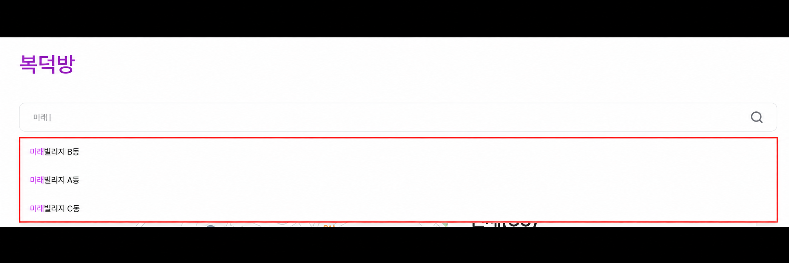

# 2-4 복덕방 목록_추천 검색어 선택

[← 복덕방 (레거시) 목록](README.md)

플랫폼: WEB  
원문 상태: 로깅 필요  
[Notion 기준 명세](https://app.notion.com/p/0bb0221954bc82d4a36581f4f824e83f)  
원본 ID: `0bb0221954bc82d4a36581f4f824e83f`

<!-- notion-body:start -->
상태: 명세 초안 · 사용자 제공 WEB 디자인 기준. SDK 구현·배포·실수집 미확인.

## 새 로깅 (26.11.17)

- 설명: 검색 입력창 아래 표시된 건물명 추천 목록에서 항목을 클릭해 선택할 때 클릭 1회당 기록한다.
- screen\_view: <code>room_list</code>
- event\_name: <code>DA1</code>
- event\_label: <code>real_estate__room_list__search_suggestion__select__click</code>
- value: \{선택한 건물명\} (예: 미래빌리지 A동)
- event\_category: <code>click</code>

### 전송 기준

각 추천 행은 같은 label을 사용하고 value에 선택한 공개 건물명을 넣는다. 입력한 검색어 원문을 value로 보내지 않는다. 이 선택으로 내부 검색 요청이 이어져도 2-3의 명시적 검색 실행을 중복 전송하지 않는다. 키보드로 추천 항목을 선택하는 계약은 이번 클릭 명세에 포함하지 않는다.

### 참고사진

<b>웹</b>

<b>참고사진 · 웹</b>

사용자 제공 복덕방 WEB 리디자인 참고 이미지다. 실기기·SDK 검증 사진이 아니며 앱 화면으로 분류하지 않는다.


웹 — 빨간 네모가 이 명세의 클릭 대상이다. 같은 화면의 다른 동작은 표시하지 않았다. 사용자 제공 WEB 디자인을 편집한 참고사진이며 실기기·SDK 검증 사진은 아니다.
<!-- notion-body:end -->

<details>
<summary>Notion 원문 속성 전체</summary>

```json
{
  "platform": [
    "WEB"
  ],
  "url": "https://app.notion.com/p/0bb0221954bc82d4a36581f4f824e83f",
  "상태": "로깅 필요",
  "생성일": "2026-11-23T13:39:22.354Z",
  "이벤트 이름": "2-4 복덕방 목록\\_추천 검색어 선택"
}
```

</details>
