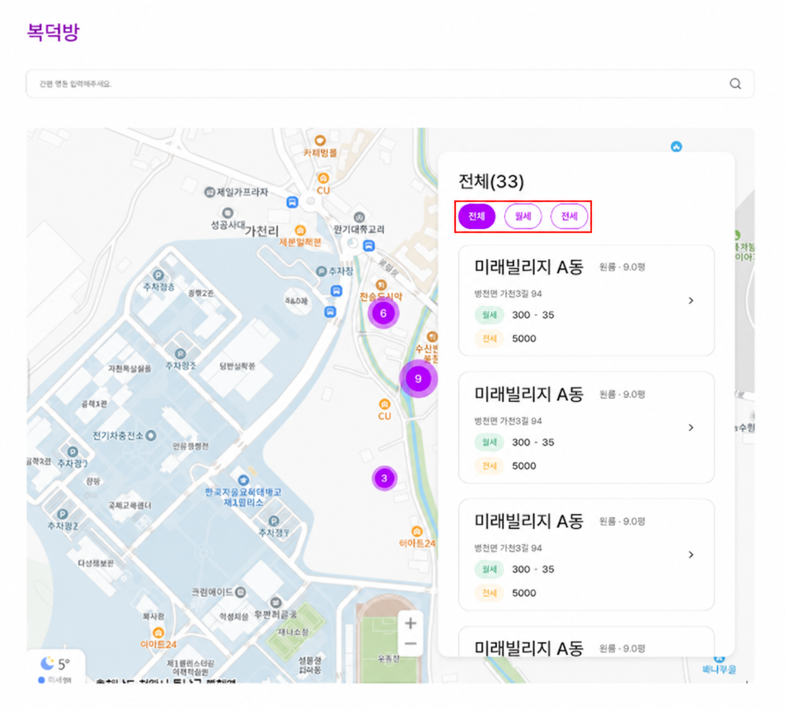

# 2-5 복덕방 목록_거래 유형 필터 선택

[← 복덕방 (레거시) 목록](README.md)

플랫폼: WEB  
원문 상태: 로깅 필요  
[Notion 기준 명세](https://app.notion.com/p/0c90221954bc825b8a3e81003cda3a84)  
원본 ID: `0c90221954bc825b8a3e81003cda3a84`

<!-- notion-body:start -->
상태: 명세 초안 · 사용자 제공 WEB 디자인 기준. SDK 구현·배포·실수집 미확인.

## 새 로깅 (26.11.17)

- 설명: 지도 오른쪽 매물 목록 상단의 전체·월세·전세 중 현재 선택과 다른 필터를 클릭해 선택이 변경될 때 1회 기록한다.
- screen\_view: <code>room_list</code>
- event\_name: <code>DA1</code>
- event\_label: <code>real_estate__room_list__contract_type__select</code>
- value: 전체 / 월세 / 전세 (예: 월세)
- event\_category: <code>select</code>

### 전송 기준

세 버튼은 하나의 계약이며 선택 후 필터값을 value로 전송한다. 초기 기본값 설정·이미 선택된 필터 재클릭·자동 필터 복원은 제외한다. 조회 결과의 성공 여부를 의미하지 않는다.

### 참고사진

<b>웹</b>

<b>참고사진 · 웹</b>

사용자 제공 복덕방 WEB 리디자인 참고 이미지다. 실기기·SDK 검증 사진이 아니며 앱 화면으로 분류하지 않는다.


웹 — 빨간 네모가 이 명세의 클릭 대상이다. 같은 화면의 다른 동작은 표시하지 않았다. 사용자 제공 WEB 디자인을 편집한 참고사진이며 실기기·SDK 검증 사진은 아니다.
<!-- notion-body:end -->

<details>
<summary>Notion 원문 속성 전체</summary>

```json
{
  "platform": [
    "WEB"
  ],
  "url": "https://app.notion.com/p/0c90221954bc825b8a3e81003cda3a84",
  "상태": "로깅 필요",
  "생성일": "2026-11-23T13:39:22.421Z",
  "이벤트 이름": "2-5 복덕방 목록\\_거래 유형 필터 선택"
}
```

</details>
