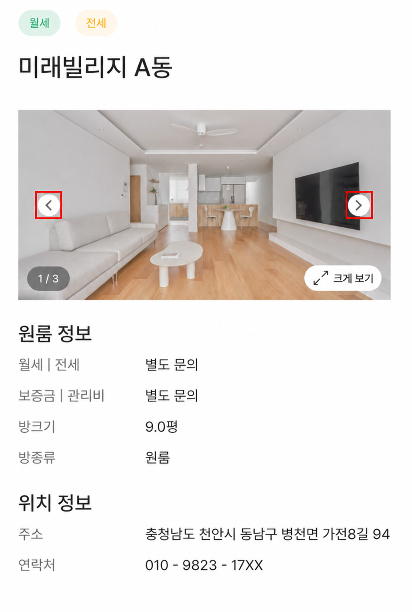
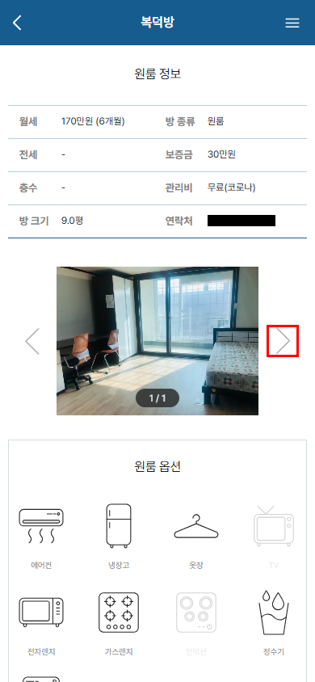

# 3-1 복덕방 상세_사진 넘기기 (클릭) - 추가된 로깅

[← 복덕방 (레거시) 목록](README.md)

플랫폼: ANDROID, IOS, WEB  
원문 상태: 로깅 필요  
[Notion 기준 명세](https://app.notion.com/p/3af0221954bc82e2947901c8639f7e05)  
원본 ID: `3af0221954bc82e2947901c8639f7e05`

<!-- notion-body:start -->
## 과거 로깅

- 없음 (새로 추가한 로깅)

## 새 로깅

- 설명: 복덕방 상세 화면의 방 사진 슬라이드에서 이전 / 다음 화살표를 클릭하는 경우
- screen\_view: <code>room_detail</code>
- event\_name: <code>DA1</code>
- event\_label: <code>real_estate__room_detail__photo_view__slide__click</code>
- value: 이전 / 다음 (예: 다음)
- event\_category: <code>click</code>

### 참고사진 (사진 슬라이드 다음 화살표)

<b>웹</b>

<b>참고사진 · 웹</b>

웹 — 사진 넘기기 (출처: stage 실제 캡처, 빨간 네모 = 클릭 위치)

사용자 제공 복덕방 WEB 리디자인의 상세 패널이다. 사진 왼쪽·오른쪽 화살표 클릭은 기존 event\_label과 이전 / 다음 value를 유지한다. 크게 보기 버튼과 확대 뷰 안의 화살표는 별도 위치의 계약이므로 이 명세와 중복 전송하지 않는다. 첨부 화면의 전화번호는 단순 표시이므로 통화·전화번호 복사 클릭을 임의로 정의하지 않는다. 앱 구현·SDK 배포·실수집 검증 사진은 아니다.


웹 — 빨간 네모가 이 명세의 클릭 대상이다. 같은 화면의 다른 동작은 표시하지 않았다. 사용자 제공 WEB 디자인을 편집한 참고사진이며 실기기·SDK 검증 사진은 아니다.

<b>모바일</b>

<b>참고사진 · 모바일</b>


모바일 웹 · 운영 [https://koreatech.in/room/4](https://koreatech.in/room/4) 실제 파란색 화면을 2026-10-30에 캡처. 빨간 테두리: 상세 사진 오른쪽의 다음 화살표. 현재 매물 사진은 1/1이므로 실제 사진 전환은 미확인. Android/iOS 네이티브 앱 캡처가 아니며 SDK 발화·한 번 전송은 미확인.
<!-- notion-body:end -->

<details>
<summary>Notion 원문 속성 전체</summary>

```json
{
  "platform": [
    "ANDROID",
    "IOS",
    "WEB"
  ],
  "url": "https://app.notion.com/p/3af0221954bc82e2947901c8639f7e05",
  "상태": "로깅 필요",
  "생성일": "2026-11-23T13:39:25.127Z",
  "이벤트 이름": "3-1 복덕방 상세\\_사진 넘기기 (클릭) - 추가된 로깅"
}
```

</details>
