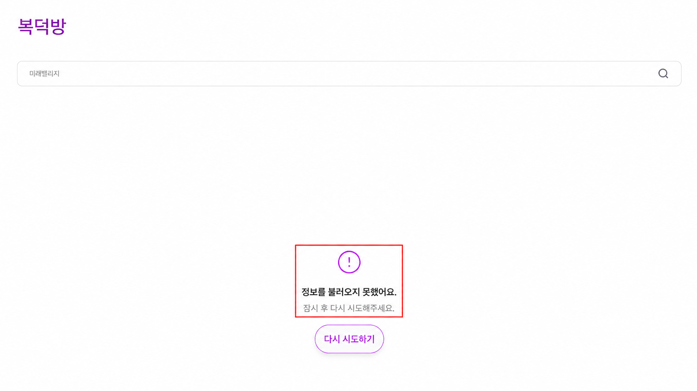

# 4-1 복덕방 목록_데이터 조회 오류 안내 노출

[← 복덕방 (레거시) 목록](README.md)

플랫폼: WEB  
원문 상태: 로깅 필요  
[Notion 기준 명세](https://app.notion.com/p/3150221954bc837ab723815697d0945a)  
원본 ID: `3150221954bc837ab723815697d0945a`

<!-- notion-body:start -->
상태: 명세 초안 · 사용자 제공 WEB 디자인 기준. SDK 구현·배포·실수집 미확인.

## 새 로깅 (26.11.17)

- 설명: 복덕방 목록 또는 검색 결과 조회 실패로 정보를 불러오지 못했어요 안내가 실제 사용자 화면에 표시될 때 안내가 새로 표시된 회차당 1회 기록한다.
- screen\_view: <code>room_list</code>
- event\_name: <code>DA1</code>
- event\_label: <code>real_estate__room_list__load_error__exposure</code>
- value: 정보를 불러오지 못했어요
- event\_category: <code>exposure</code>

### 전송 기준

재렌더·시간 경과만으로 중복 전송하지 않는다. 새로운 재시도 뒤 다시 오류 안내가 표시되면 별도 회차로 기록할 수 있다. HTTP 요청 시작 자체·검색 결과 없음 상태는 포함하지 않는다.

### 참고사진

<b>웹</b>

<b>참고사진 · 웹</b>

사용자 제공 복덕방 WEB 리디자인 참고 이미지다. 실기기·SDK 검증 사진이 아니며 앱 화면으로 분류하지 않는다.


웹 — 빨간 네모는 안내 노출을 확인하는 영역이다. 클릭 위치가 아니며 버튼은 제외했다. 사용자 제공 WEB 디자인을 편집한 참고사진이며 실기기·SDK 검증 사진은 아니다.
<!-- notion-body:end -->

<details>
<summary>Notion 원문 속성 전체</summary>

```json
{
  "platform": [
    "WEB"
  ],
  "url": "https://app.notion.com/p/3150221954bc837ab723815697d0945a",
  "상태": "로깅 필요",
  "생성일": "2026-11-23T13:39:23.901Z",
  "이벤트 이름": "4-1 복덕방 목록\\_데이터 조회 오류 안내 노출"
}
```

</details>
