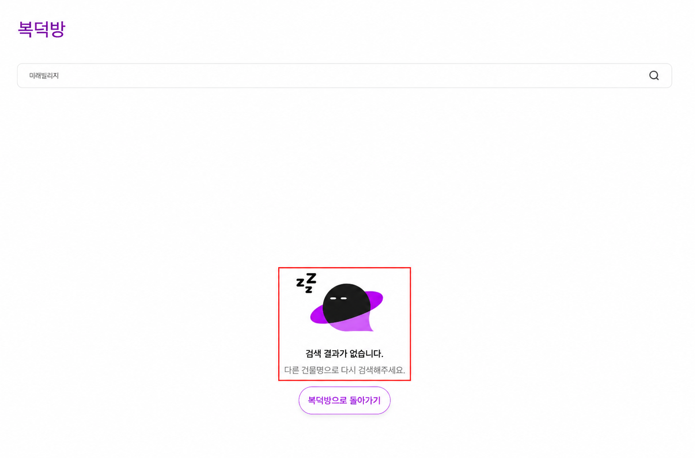

# [레거시] 4-3 복덕방 목록_검색 결과 없음 안내 노출

[← 레거시 복덕방 목록](README.md)

> 레거시 참고 명세입니다. 현행 구현·신규 전송의 기준으로 사용하지 않습니다.

생성일: 2026년 11월 17일 오전 9:59
platform: WEB
상태: 로깅 필요

상태: 명세 초안 · 사용자 제공 WEB 디자인 기준. SDK 구현·배포·실수집 미확인.

## 새 로깅 (26.11.17)

- 설명: 검색 요청이 정상 처리됐지만 결과가 0건이어서 검색 결과가 없습니다 안내가 실제 화면에 표시될 때 해당 검색 결과 표시 회차당 1회 기록한다.
- screen_view: `room_list`
- event_name: `DA1`
- event_label: `real_estate__room_list__search_empty__exposure`
- value: 검색 결과가 없습니다
- event_category: `exposure`

### 전송 기준

요청 중 임시 빈 목록·통신 오류·초기 화면을 결과 없음으로 기록하지 않는다. 같은 결과의 재렌더에는 중복 전송하지 않는다. 검색어 원문은 전송하지 않는다.

### 참고사진

**웹**

**참고사진 · 웹**

사용자 제공 복덕방 WEB 리디자인 참고 이미지다. 실기기·SDK 검증 사진이 아니며 앱 화면으로 분류하지 않는다.

웹 — 빨간 네모는 안내 노출을 확인하는 영역이다. 클릭 위치가 아니며 버튼은 제외했다. 사용자 제공 WEB 디자인을 편집한 참고사진이며 실기기·SDK 검증 사진은 아니다.