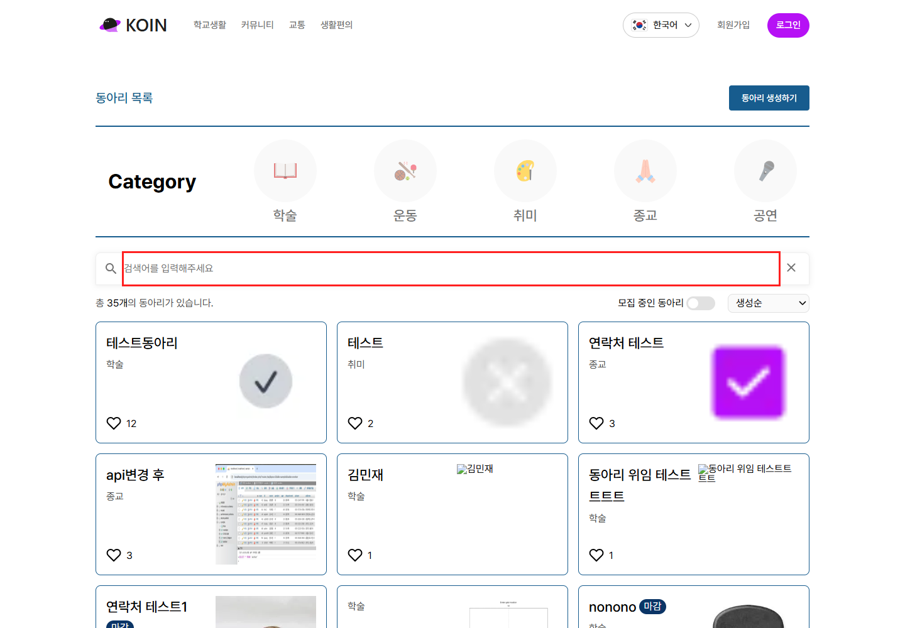

# 1-2 동아리 검색창 클릭

[← 동아리 목록](README.md)

플랫폼: WEB  
원문 상태: 로깅 필요  
[Notion 기준 명세](https://app.notion.com/p/4260221954bc8068bdebe0cc9a6410ce)  
원본 ID: `4260221954bc8068bdebe0cc9a6410ce`

<!-- notion-body:start -->
## 새 로깅 (26.11.28)

- 설명: 검색 입력창을 사용자가 직접 클릭하거나 탭할 때 1회 기록한다. 자동 focus·키 입력마다·초기 렌더에서는 전송하지 않는다. 검색 실행이나 검색 결과 진입과 구분한다.
- 적용 플랫폼: WEB · PC 웹 전용
- screen\_view: <code>club_list</code>
- event\_name: <code>DA1</code>
- event\_label: <code>club__club_list__search__search_input__click</code>
- value: 검색창
- event\_category: <code>click</code>

### 참고사진 · 실제 Stage 클릭 대상


PC 웹 실제 Stage 캡처 · 빨간 네모가 해당 동작의 대상 위치다. 화면 확인이며 SDK 전송·수집 정상 판정을 뜻하지 않는다.
<!-- notion-body:end -->

<details>
<summary>Notion 원문 속성 전체</summary>

```json
{
  "platform": [
    "WEB"
  ],
  "url": "https://app.notion.com/p/4260221954bc8068bdebe0cc9a6410ce",
  "상태": "로깅 필요",
  "이름": "1-2 동아리 검색창 클릭",
  "태그": [
    "1.동아리"
  ]
}
```

</details>
