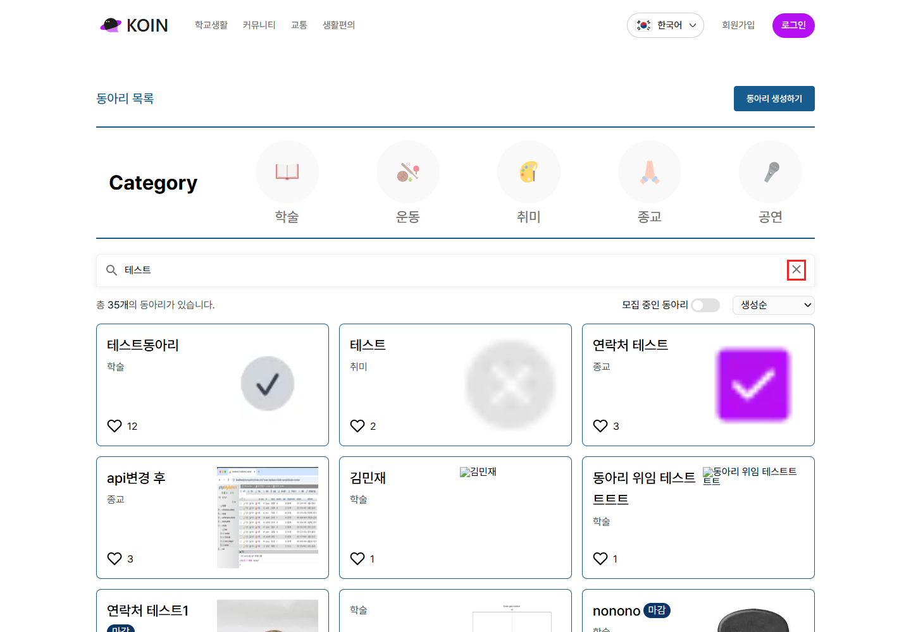

# 1-3 동아리 검색어 삭제

[← 동아리 목록](README.md)

플랫폼: WEB  
원문 상태: 로깅 필요  
[Notion 기준 명세](https://app.notion.com/p/4260221954bc8031b01cf0ebd7994de7)  
원본 ID: `4260221954bc8031b01cf0ebd7994de7`

<!-- notion-body:start -->
## 과거 로깅

없음

## 새 로깅 (26.11.28)

- 설명: 검색어가 있는 상태에서 검색어 삭제 버튼을 눌러 입력값을 지울 때 1회 기록한다. 초기 빈 입력·자동 초기화에는 전송하지 않는다.
- 적용 플랫폼: WEB · PC 웹 전용
- screen\_view: <code>club_list</code>
- event\_name: <code>DA1</code>
- event\_label: <code>club__club_list__search__clear__click</code>
- value: 검색어 삭제
- event\_category: <code>click</code>

### 참고사진 · 실제 Stage 클릭 대상


PC 웹 실제 Stage 캡처 · 빨간 네모가 해당 동작의 대상 위치다. 화면 확인이며 SDK 전송·수집 정상 판정을 뜻하지 않는다.
<!-- notion-body:end -->

<details>
<summary>Notion 원문 속성 전체</summary>

```json
{
  "platform": [
    "WEB"
  ],
  "url": "https://app.notion.com/p/4260221954bc8031b01cf0ebd7994de7",
  "상태": "로깅 필요",
  "이름": "1-3 동아리 검색어 삭제",
  "태그": [
    "1.동아리"
  ]
}
```

</details>
