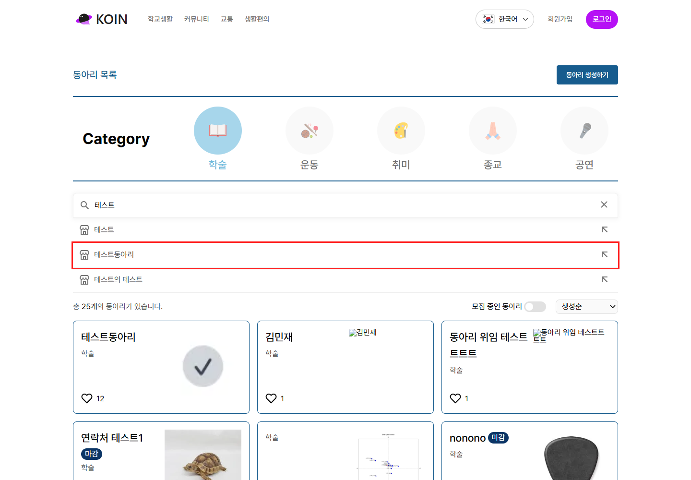

# 1-4 동아리 검색 결과 진입

[← 동아리 목록](README.md)

플랫폼: WEB  
원문 상태: 로깅 필요  
[Notion 기준 명세](https://app.notion.com/p/4260221954bc805da251ced003dfe859)  
원본 ID: `4260221954bc805da251ced003dfe859`

<!-- notion-body:start -->
## 과거 로깅

관련 참고: [[레거시] 2.7 동아리_동아리 검색](https://app.notion.com/p/ebd0221954bc828da16b018d36ed13e5). 원문은 검색어를 value로 기록하므로 검색창 클릭·삭제·자동완성 결과 진입과 같은 이벤트라고 단정하지 않는다.

## 새 로깅 (26.11.28)

- 설명: 검색 자동완성 결과의 동아리 항목을 클릭해 해당 상세로 이동을 시도할 때 1회 기록한다. 일반 목록 카드와 구분한다. 검색어 원문이나 질의 문자열은 value로 전송하지 않는다.
- 적용 플랫폼: WEB · PC 웹 전용
- screen\_view: <code>club_list</code>
- event\_name: <code>DA1</code>
- event\_label: <code>club__club_list__club_detail__search_entry__click</code>
- value: \{사용자가 클릭한 동아리 이름\}
- event\_category: <code>click</code>

### 참고사진 · 실제 Stage 클릭 대상


PC 웹 실제 Stage 화면 · 빨간 네모가 해당 동작의 대상 위치다.
<!-- notion-body:end -->

<details>
<summary>Notion 원문 속성 전체</summary>

```json
{
  "platform": [
    "WEB"
  ],
  "url": "https://app.notion.com/p/4260221954bc805da251ced003dfe859",
  "상태": "로깅 필요",
  "이름": "1-4 동아리 검색 결과 진입",
  "태그": [
    "1.동아리"
  ]
}
```

</details>
