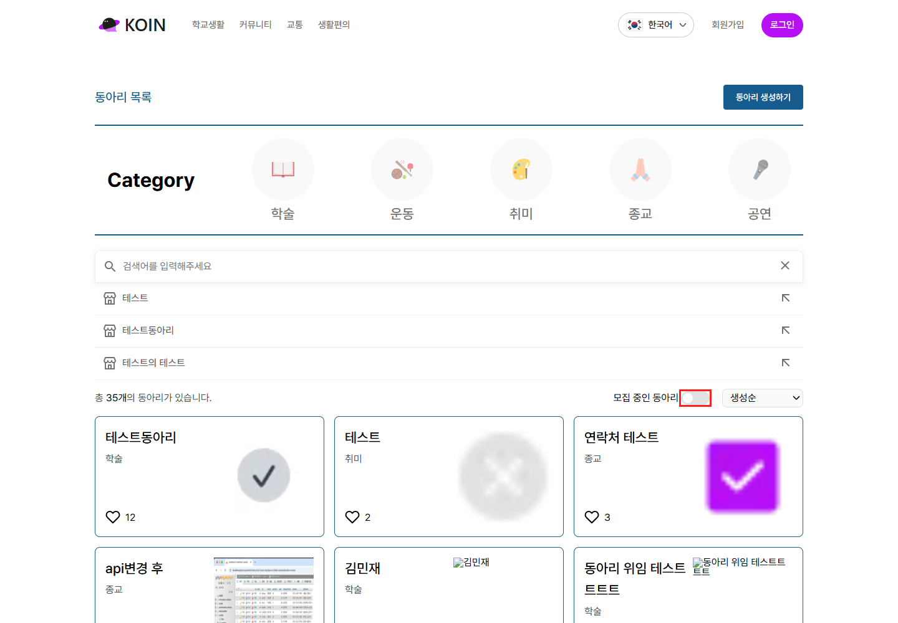

# 1-5 모집 중인 동아리 필터

[← 동아리 목록](README.md)

플랫폼: WEB  
원문 상태: 로깅 필요  
[Notion 기준 명세](https://app.notion.com/p/4260221954bc80429979e907dd1260d0)  
원본 ID: `4260221954bc80429979e907dd1260d0`

<!-- notion-body:start -->
## 과거 로깅

원문: [[레거시] 2.6 동아리_모집 중인 동아리 토글 클릭](https://app.notion.com/p/1030221954bc83d0995601cca207320e)

- event\_name: <code>“CAMPUS”</code>
- event\_label: <code>“club_main_recruiting_toggle”</code>
- value: <code>{on / off} // ‘on’ 또는 ‘off’ 값을 가지는 형태</code>
- event\_category: <code>“click”</code>

과거 값과 따옴표·대소문자 표기는 원문 이력이다. 신규 전송값이나 정상 별칭으로 사용하지 않는다. UI 위치 대응이며 SDK 호출 시점·적용 버전의 동일성까지 확정한 것은 아니다.

## 새 로깅 (26.11.28)

- 설명: 모집 중인 동아리 스위치를 사용자가 직접 클릭할 때 클릭으로 요청한 on/off를 한국어 값(모집 중 보기 설정/해제)으로 1회 기록한다. 초기 표시·단순 노출·재조회는 제외하며 서버 결과를 기다리는 성공 이벤트가 아니다.
- 적용 플랫폼: WEB · PC 웹 전용
- screen\_view: <code>club_list</code>
- event\_name: <code>DA1</code>
- event\_label: <code>club__club_list__filter__recruiting__click</code>
- value: 모집 중 보기 설정 또는 모집 중 보기 해제
- event\_category: <code>click</code>

### 참고사진 · 실제 Stage 클릭 대상


PC 웹 실제 Stage 캡처 · 빨간 네모가 해당 동작의 대상 위치다. 화면 확인이며 SDK 전송·수집 정상 판정을 뜻하지 않는다.
<!-- notion-body:end -->

<details>
<summary>Notion 원문 속성 전체</summary>

```json
{
  "platform": [
    "WEB"
  ],
  "url": "https://app.notion.com/p/4260221954bc80429979e907dd1260d0",
  "상태": "로깅 필요",
  "이름": "1-5 모집 중인 동아리 필터",
  "태그": [
    "1.동아리"
  ]
}
```

</details>
