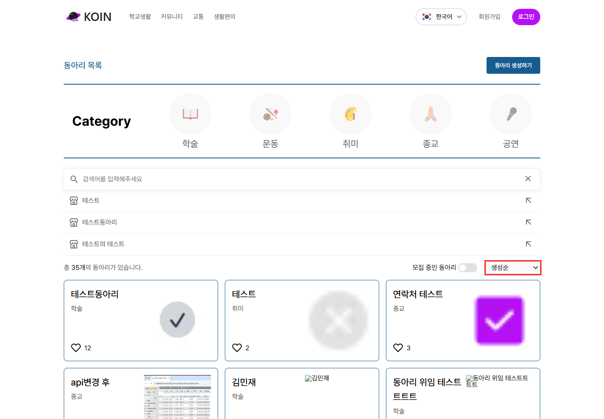

# 1-6 동아리 목록 정렬 선택

[← 동아리 목록](README.md)

플랫폼: WEB  
원문 상태: 로깅 필요  
[Notion 기준 명세](https://app.notion.com/p/4260221954bc80ca8bdff5fded3fbad2)  
원본 ID: `4260221954bc80ca8bdff5fded3fbad2`

<!-- notion-body:start -->
## 과거 로깅

없음

## 새 로깅 (26.11.28)

- 설명: 열린 정렬 메뉴에서 다른 기준을 선택해 정렬 상태가 변경될 때 변경 후 기준을 1회 기록한다. 드롭다운 열기·현재 항목 재선택·자동 정렬은 제외한다.
- 적용 플랫폼: WEB · PC 웹 전용
- screen\_view: <code>club_list</code>
- event\_name: <code>DA1</code>
- event\_label: <code>club__club_list__filter__sort__select</code>
- value: 생성순 또는 조회순
- event\_category: <code>select</code>

### 참고사진 · 실제 Stage 클릭 대상


PC 웹 실제 Stage 캡처 · 빨간 네모가 해당 동작의 대상 위치다. 화면 확인이며 SDK 전송·수집 정상 판정을 뜻하지 않는다.
<!-- notion-body:end -->

<details>
<summary>Notion 원문 속성 전체</summary>

```json
{
  "platform": [
    "WEB"
  ],
  "url": "https://app.notion.com/p/4260221954bc80ca8bdff5fded3fbad2",
  "상태": "로깅 필요",
  "이름": "1-6 동아리 목록 정렬 선택",
  "태그": [
    "1.동아리"
  ]
}
```

</details>
