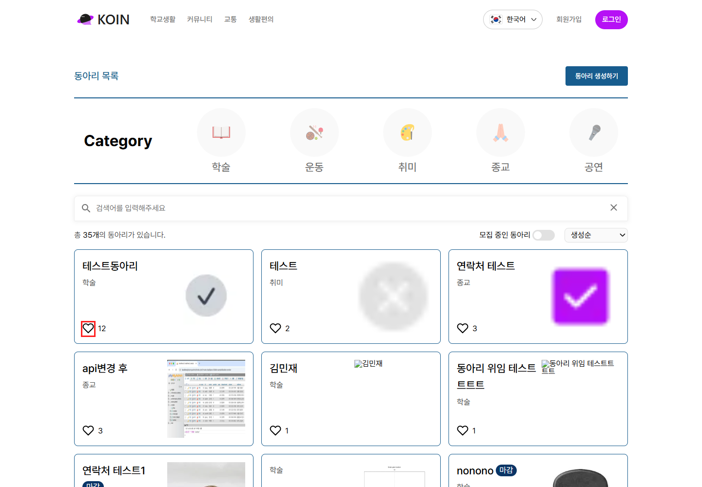

# 1-8-2 동아리 목록 좋아요 해제

[← 동아리 목록](README.md)

플랫폼: WEB  
원문 상태: 로깅 필요  
[Notion 기준 명세](https://app.notion.com/p/4260221954bc80e8bb4ff8f7596a7fd4)  
원본 ID: `4260221954bc80e8bb4ff8f7596a7fd4`

<!-- notion-body:start -->
## 과거 로깅

원문: [[레거시] 2-5.동아리_동아리 메인화면 좋아요 해제](https://app.notion.com/p/fcb0221954bc832f811d01195c2c92d2)

- event\_name: <code>“CAMPUS”</code>
- event\_label: <code>“club_main_like_cancel”</code>
- value: <code>“동아리명”</code>
- event\_category: <code>“click”</code>

## 새 로깅 (26.11.28)

- 설명: 이미 좋아요한 목록 카드의 하트 버튼을 눌러 좋아요 해제를 요청할 때 1회 기록한다. 해제 성공 이벤트가 아니며 카드 진입 로그를 함께 보내지 않는다.
- 적용 플랫폼: WEB · PC 웹 전용
- screen\_view: <code>club_list</code>
- event\_name: <code>DA1</code>
- event\_label: <code>club__club_list__like__remove__click</code>
- value: 좋아요 해제
- event\_category: <code>click</code>

### 참고사진 · 실제 Stage 클릭 대상


PC 웹 하트 버튼 위치 참고. 좋아요 선택·해제 상태와 로그인 후 실제 전송은 미검증이다.
<!-- notion-body:end -->

<details>
<summary>Notion 원문 속성 전체</summary>

```json
{
  "platform": [
    "WEB"
  ],
  "url": "https://app.notion.com/p/4260221954bc80e8bb4ff8f7596a7fd4",
  "상태": "로깅 필요",
  "이름": "1-8-2 동아리 목록 좋아요 해제",
  "태그": [
    "1.동아리"
  ]
}
```

</details>
