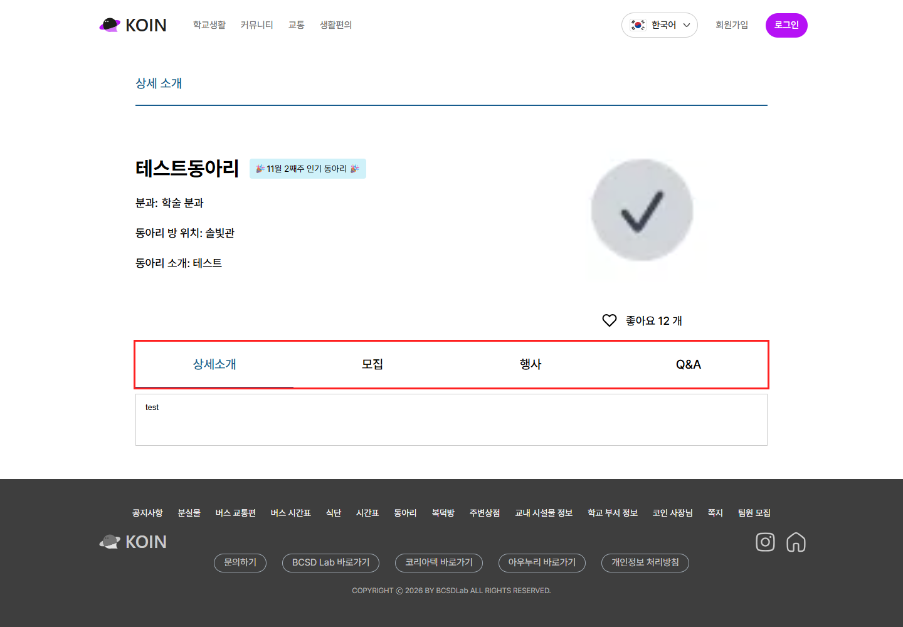

# 2-1 동아리 상세 탭 선택

[← 동아리 목록](README.md)

플랫폼: WEB  
원문 상태: 로깅 필요  
[Notion 기준 명세](https://app.notion.com/p/4260221954bc8015b7c4e1b28b54f62f)  
원본 ID: `4260221954bc8015b7c4e1b28b54f62f`

<!-- notion-body:start -->
## 과거 로깅

원문: [[레거시] 5-6.동아리_탭 클릭(추가사항)](https://app.notion.com/p/9db0221954bc832fad1581f3640e91b6)

- event\_name: <code>“CAMPUS”</code>
- event\_label: <code>“club_tab_select”</code>
- value: <code>{”상세 소개”, “Q&amp;A”, “모집”, “행사”}</code>
- event\_category: <code>“click”</code>

과거 값과 따옴표·대소문자 표기는 원문 이력이다. 신규 전송값이나 정상 별칭으로 사용하지 않는다. UI 위치 대응이며 SDK 호출 시점·적용 버전의 동일성까지 확정한 것은 아니다.

## 새 로깅 (26.11.28)

- 설명: 상세 화면에서 사용자가 탭을 직접 클릭할 때 누른 탭값을 1회 기록한다. 첫 진입의 기본 표시·직접 URL 진입·자동 렌더는 제외한다. 이름 정리만으로 과거 click을 select로 바꾸지 않는다.
- 적용 플랫폼: WEB · PC 웹 전용
- screen\_view: <code>club_detail</code>
- event\_name: <code>DA1</code>
- event\_label: <code>club__club_detail__filter__tab__click</code>
- value: 상세 소개 또는 모집 또는 행사 또는 질의응답
- event\_category: <code>click</code>

### 참고사진 · 실제 Stage 클릭 대상


PC 웹 실제 Stage 캡처 · 빨간 네모가 해당 동작의 대상 위치다. 화면 확인이며 SDK 전송·수집 정상 판정을 뜻하지 않는다.
<!-- notion-body:end -->

<details>
<summary>Notion 원문 속성 전체</summary>

```json
{
  "platform": [
    "WEB"
  ],
  "url": "https://app.notion.com/p/4260221954bc8015b7c4e1b28b54f62f",
  "상태": "로깅 필요",
  "이름": "2-1 동아리 상세 탭 선택",
  "태그": [
    "1.동아리"
  ]
}
```

</details>
