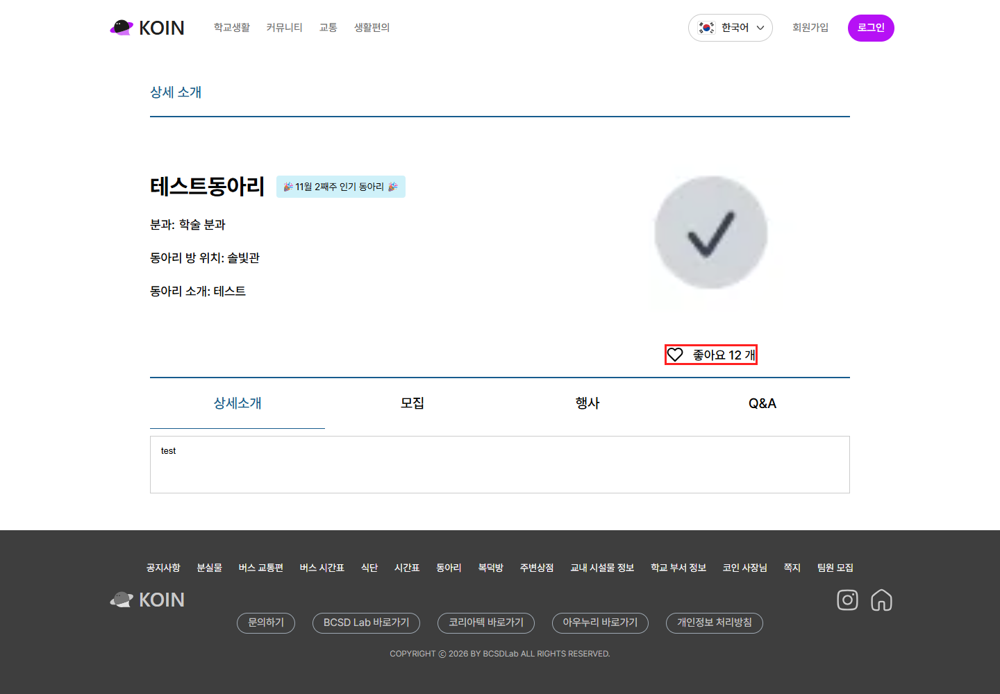

# 2-2 동아리 상세 좋아요 버튼

[← 동아리 목록](README.md)

플랫폼: WEB  
원문 상태: 로깅 필요  
[Notion 기준 명세](https://app.notion.com/p/4260221954bc80c587baff9c3e52f5af)  
원본 ID: `4260221954bc80c587baff9c3e52f5af`

<!-- notion-body:start -->
## 과거 로깅

원문: [[레거시] 5-12.동아리_상세소개 좋아요 클릭](https://app.notion.com/p/2820221954bc82f9ac748148effdac09)

- event\_name: <code>“CAMPUS”</code>
- event\_label: <code>“club_introduction_like”</code>
- value: <code>“동아리명”</code>
- event\_category: <code>“click”</code>

원문: [[레거시] 5-13.동아리_상세소개 좋아요 해제](https://app.notion.com/p/6730221954bc83d9928001a5879cf882)

- event\_name: <code>“CAMPUS”</code>
- event\_label: <code>“club_introduction_like_cancel”</code>
- value: <code>“동아리명”</code>
- event\_category: <code>“click”</code>

과거 값과 따옴표·대소문자 표기는 원문 이력이다. 신규 전송값이나 정상 별칭으로 사용하지 않는다. UI 위치 대응이며 SDK 호출 시점·적용 버전의 동일성까지 확정한 것은 아니다.<br />과거 좋아요·해제는 서로 다른 라벨이었다. 원문 value는 동아리명으로만 표시돼 동적 값 여부를 임의 확정하지 않는다. 현재 새 계약은 버튼 클릭 시도이며 두 과거 이벤트의 저장·해제 결과를 대체하지 않는다.

## 새 로깅 (26.11.28)

- 설명: 상세 요약 영역의 좋아요 버튼을 직접 누른 시도를 1회 기록한다. 비로그인 로그인 안내와 서버의 실제 좋아요 저장·해제 성공을 구분한다. 목록 하트 계약은 전송하지 않는다.
- 적용 플랫폼: WEB · PC 웹 전용
- screen\_view: <code>club_detail</code>
- event\_name: <code>DA1</code>
- event\_label: <code>club__club_detail__like__click</code>
- value: 좋아요 버튼
- event\_category: <code>click</code>

### 참고사진 · 실제 Stage 클릭 대상


PC 웹 실제 Stage 캡처 · 빨간 네모가 해당 동작의 대상 위치다. 화면 확인이며 SDK 전송·수집 정상 판정을 뜻하지 않는다.
<!-- notion-body:end -->

<details>
<summary>Notion 원문 속성 전체</summary>

```json
{
  "platform": [
    "WEB"
  ],
  "url": "https://app.notion.com/p/4260221954bc80c587baff9c3e52f5af",
  "상태": "로깅 필요",
  "이름": "2-2 동아리 상세 좋아요 버튼",
  "태그": [
    "1.동아리"
  ]
}
```

</details>
