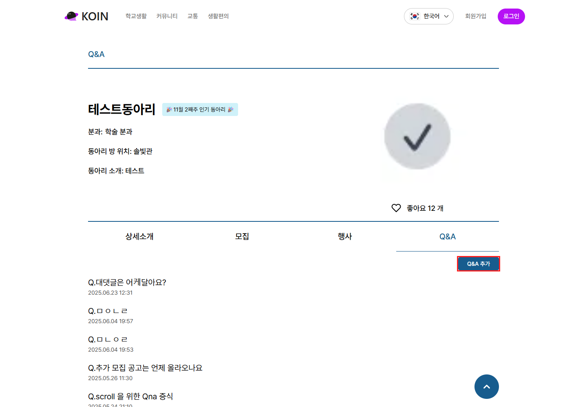

# 2-5 동아리 질의응답 추가 진입

[← 동아리 목록](README.md)

플랫폼: WEB  
원문 상태: 로깅 필요  
[Notion 기준 명세](https://app.notion.com/p/4260221954bc80a98bf1f923ba9af916)  
원본 ID: `4260221954bc80a98bf1f923ba9af916`

<!-- notion-body:start -->
## 과거 로깅

원문: [[레거시] 4-1. 동아리_Q&A추가](https://app.notion.com/p/7380221954bc820fabbb01a135d45979)

- event\_name: <code>“CAMPUS”</code>
- event\_label: <code>“club_Q&amp;A_add”</code>
- value: <code>“Q&amp;A”</code>
- event\_category: <code>“click”</code>

과거 값과 따옴표·대소문자 표기는 원문 이력이다. 신규 전송값이나 정상 별칭으로 사용하지 않는다. UI 위치 대응이며 SDK 호출 시점·적용 버전의 동일성까지 확정한 것은 아니다.

## 새 로깅 (26.11.28)

- 설명: Q&A 탭의 Q&A 추가 버튼을 직접 클릭할 때 1회 기록한다. 비로그인 로그인 안내 표시를 포함한 진입 시도이며 질문 작성 제출·서버 저장 성공이 아니다. 질문·답변 원문을 수집하지 않는다.
- 적용 플랫폼: WEB · PC 웹 전용
- screen\_view: <code>club_detail</code>
- event\_name: <code>DA1</code>
- event\_label: <code>club__club_detail__qna_write__entry__click</code>
- value: 질의응답 추가
- event\_category: <code>click</code>

### 참고사진 · 실제 Stage 클릭 대상


PC 웹 실제 Stage 캡처 · 빨간 네모가 해당 동작의 대상 위치다. 화면 확인이며 SDK 전송·수집 정상 판정을 뜻하지 않는다.
<!-- notion-body:end -->

<details>
<summary>Notion 원문 속성 전체</summary>

```json
{
  "platform": [
    "WEB"
  ],
  "url": "https://app.notion.com/p/4260221954bc80a98bf1f923ba9af916",
  "상태": "로깅 필요",
  "이름": "2-5 동아리 질의응답 추가 진입",
  "태그": [
    "1.동아리"
  ]
}
```

</details>
