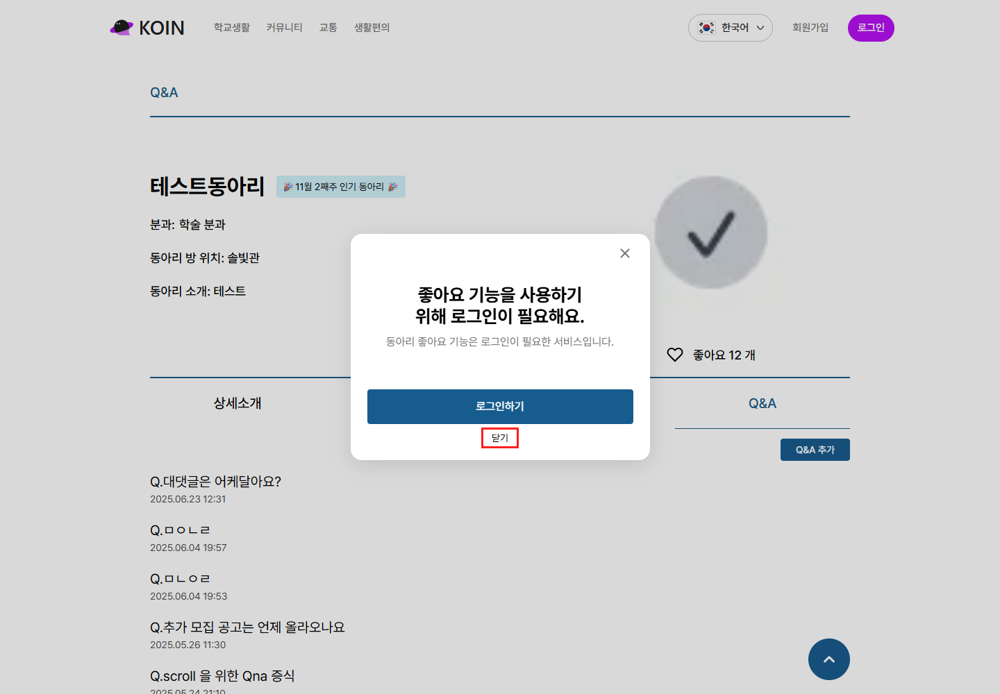

# 3-2-2 상세 로그인 안내 닫기

[← 동아리 목록](README.md)

플랫폼: WEB  
원문 상태: 로깅 필요  
[Notion 기준 명세](https://app.notion.com/p/4260221954bc80589b28f02e93535f04)  
원본 ID: `4260221954bc80589b28f02e93535f04`

<!-- notion-body:start -->
## 새 로깅 (26.11.28)

- 설명: 동아리 기능의 로그인 안내에서 닫기 또는 X 닫기 버튼을 직접 클릭해 안내를 닫을 때 1회 기록한다. 자동 닫힘·바깥 영역 클릭·로그인 이동으로 사라지는 경우는 별도 닫기로 보내지 않는다.
- 적용 플랫폼: WEB · PC 웹 전용
- screen\_view: <code>club_detail</code>
- event\_name: <code>DA1</code>
- event\_label: <code>account__club_detail__login_popup__close__click</code>
- value: 닫기
- event\_category: <code>click</code>

### 참고사진 · 실제 Stage 클릭 대상


PC 웹 실제 Stage 캡처 · 빨간 네모가 해당 동작의 대상 위치다. 화면 확인이며 SDK 전송·수집 정상 판정을 뜻하지 않는다.
<!-- notion-body:end -->

<details>
<summary>Notion 원문 속성 전체</summary>

```json
{
  "platform": [
    "WEB"
  ],
  "url": "https://app.notion.com/p/4260221954bc80589b28f02e93535f04",
  "상태": "로깅 필요",
  "이름": "3-2-2 상세 로그인 안내 닫기",
  "태그": [
    "1.동아리"
  ]
}
```

</details>
